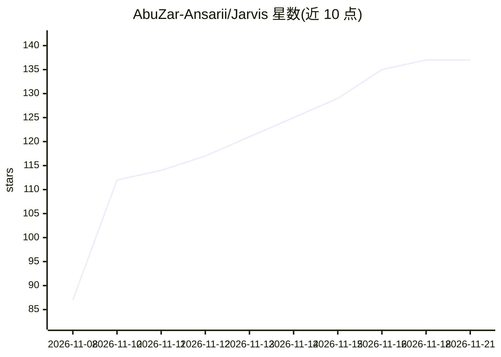

# AbuZar-Ansarii/Jarvis

⭐ 137 · Dart · MIT · 推送 2026-11-06 · [GitHub](https://github.com/AbuZar-Ansarii/Jarvis) · 个人维护

**安卓端本地优先的自主 AI 助手与系统自动化框架**

面向终端用户的 Android 应用：通过无障碍服务读取界面结构，结合 LLM（云端 OpenAI 兼容后端或本地 Ollama）自动执行多步点击、输入、滑动等 UI 操作；提供语音唤醒与连续听写、双 3D 全息 HUD、隔空手势、实时语音翻译、浮动副驾驶等能力。内置 Hermes 自进化引擎，将重复交互沉淀为宏技能并维护 SOUL/USER/AGENT 三份上下文文件。采用本地优先隐私架构，零追踪零遥测。用 Flutter/Dart 开发，需从源码构建。

## 筛选速览

| 维度 | 判定 | 备注 |
|---|---|---|
| AI 角色 | `ai-native` | 本体是模型或模型工具 |
| 许可风险 | `permissive` | MIT |
| 部署形态 | `None` |  |
| 模型依赖 | local-ok | 支持本地模型 |
| 硬件要求 | — | 无带数字的原话,不猜 |
| 安装摩擦 | `medium` | 含编译或系统依赖之一 |
| 成熟度 | — | 结构信号不足 |

## 能力要点

- 无障碍服务读取界面层级，LLM 决策并自主执行触摸交互
- Hermes 引擎将重复操作蒸馏为可本地回放的宏技能，维护 SOUL/USER/AGENT 上下文
- 本地优先隐私架构，兼容全离线 Ollama 实例
- 连续语音监听、隔空手势、ADS-B 飞机雷达等硬件传感器集成

## 适用场景

- 用语音或对话让手机自动操作任意应用完成多步任务
- 桌面/车载场景下的免提持续语音助手
- 在聊天、购物应用上叠加悬浮 AI 副驾驶做回复草拟与安全提示

## 场景标签

`AI 助手` `语音 Agent` `GUI 自动化` · 领域:效率与自动化

## 证据(README 行号)

> L20: **J.A.R.V.I.S.** (PrivateAgent) is an autonomous, on-device AI assistant, system automation framework, and cybernet
> L22: Unlike conventional voice assistants that merely return web searches or canned voice responses, J.A.R.V.I.S. acts a

## 星数曲线

2026-11-08 87 → 2026-11-21 137（+50）

---
*卡片 v1 · prompt 1.4 · 生成 2026-11-17 · 置信度 high · 依据 README sha `5be940fee1f3` · [字段定义](../../DATASET.md)*
