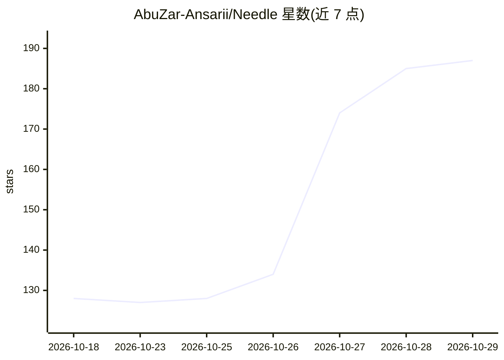

# AbuZar-Ansarii/Needle

⭐ 187 · Python · 推送 2026-10-22 · [GitHub](https://github.com/AbuZar-Ansarii/Needle) · 个人维护

**Android/Termux 上的超轻量本地 agentic 助手，用自然语言控制手机**

基于 Cactus Compute 的 Needle 3 与 Needle 2（14MB）模型，在 Android Termux（经 PRoot Ubuntu）本地运行的智能体助手：将英文指令（开手电、查电量、发短信、截屏、NFC 扫描等）翻译为手机 API 调用，支持语音交互循环、本地 SQLite 个人知识库与 3072 维设备端嵌入的语义搜索、离线拍照提取结构化 JSON、短信/通知分类。提供 Flask Web UI、CLI 与 Telegram 远程控制三种入口，可在运行中切换模型，并有 Windows/macOS 桌面模拟模式。需 Python 3 环境与 Termux:API 应用，安装经 git clone 与 pip 完成。

## 筛选速览

| 维度 | 判定 | 备注 |
|---|---|---|
| AI 角色 | `ai-native` | 本体是模型或模型工具 |
| 许可风险 | `none` | — |
| 部署形态 | `desktop` | 安装包/桌面程序 |
| 模型依赖 | — | README 未给出锁定关系 |
| 硬件要求 | — | 无带数字的原话,不猜 |
| 安装摩擦 | `low` | 无编译、无系统依赖或容器化 |
| 成熟度 | — | 结构信号不足 |

## 能力要点

- 自然语言转手机硬件/系统 API 调用（手电、传感器、Wi-Fi、短信、通话等）
- Needle 3 与 Needle 2 双模型，Web UI/CLI/Telegram 运行中切换
- 本地 RAG：SQLite 存储与 3072 维设备端嵌入语义搜索
- 离线语音循环（语音识别 + termux-tts-speak）与拍照结构化 JSON 提取

## 适用场景

- 用英文口语指令操控手机硬件与系统功能
- 通过 Telegram 远程向手机下达命令并获取结果
- 在本地离线保存笔记/凭据并做语义检索

## 场景标签

`知识库管理` `GUI 自动化` · 领域:效率与自动化

## 证据(README 行号)

> L1: # Termux Agentic Assistant (Needle 3 & Needle 2 LLM)
> L3: An ultra-lightweight, local agentic assistant for Android/Termux that controls phone hardware and parses queries in 
> L10: - **Dual Model Support (Needle 3 & Needle 2):** Use the latest **Needle 3** model for superior reasoning, sliceable

## 星数曲线

2026-10-18 128 → 2026-10-29 187（+59）

---
*卡片 v1 · prompt 1.4 · 生成 2026-10-23 · 置信度 high · 依据 README sha `4b58acbce71c` · [字段定义](../../DATASET.md)*
