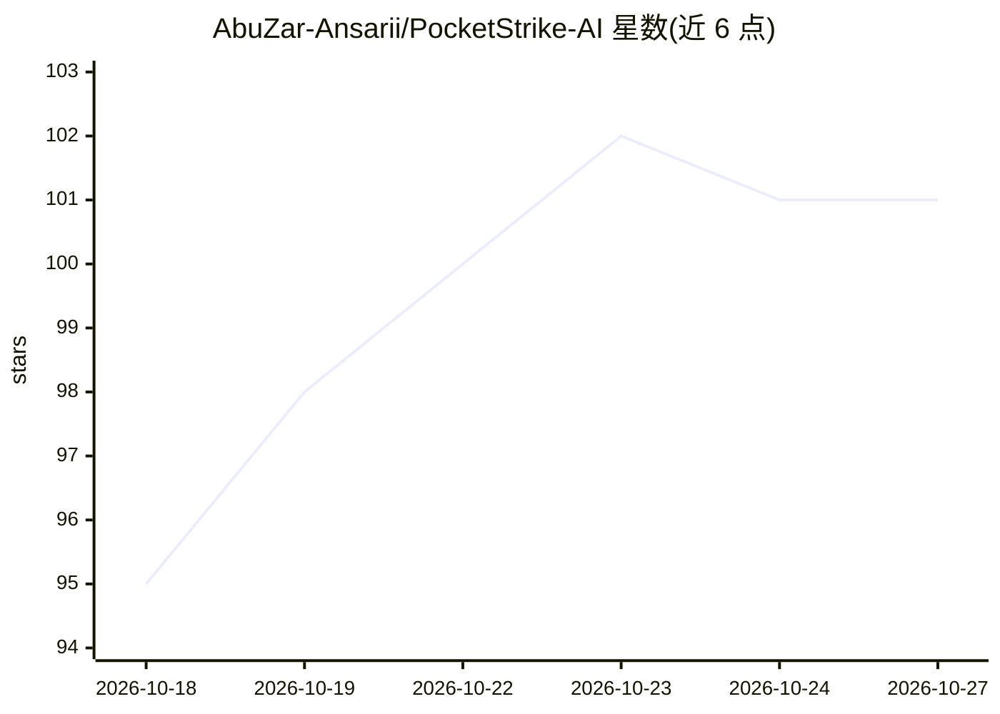

# AbuZar-Ansarii/PocketStrike-AI

⭐ 101 · Python · MIT · 推送 2026-09-08 · [GitHub](https://github.com/AbuZar-Ansarii/PocketStrike-AI) · 个人维护

**把手机/PC 变成自主 AI 代理的轻量 ReAct 编排器**

在 Android Termux、Linux、macOS、Windows 上运行的轻量 AI 代理核心：本地跑 ReAct 状态引擎，把重推理委托给远程 API 或本地 Ollama，支持 Gemini/OpenAI/Claude/OpenRouter 等提供方。提供约 50 个系统工具（网络扫描、ADB 控制、定时任务、沙箱 Python、RAG 搜索）、MCP 客户端（HTTP/SSE）、Telegram Bot 后端与统一 Web UI，并含语音助手与 ARP 欺骗检测守护线程。Flask 后台内存占用 30-50MB。

## 筛选速览

| 维度 | 判定 | 备注 |
|---|---|---|
| AI 角色 | `ai-native` | 本体是模型或模型工具 |
| 许可风险 | `permissive` | MIT |
| 部署形态 | `library` | 以包/库形式分发 |
| 模型依赖 | local-ok | 支持本地模型 |
| 硬件要求 | — | 无带数字的原话,不猜 |
| 安装摩擦 | `low` | 无编译、无系统依赖或容器化 |
| 成熟度 | — | 结构信号不足 |

## 能力要点

- 本地 ReAct 状态引擎 + 原生 MCP（HTTP/SSE）客户端
- 约 50 个系统工具：网络扫描、ADB 控制、后台调度、沙箱 Python
- Telegram Bot 与 Web UI 统一会话同步，60 条消息滑动窗口
- 后台语音助手（Hey Strike）与 ARP 欺骗/MitM 检测告警

## 适用场景

- 在手机 Termux 上运行可调用系统与网络工具的 AI 代理
- 通过 Telegram 远程触发工具、查调度、对话
- 通过 MCP 连接 PC/局域网上的远程工具服务器
- 低配设备上跑轻量代理（内存占用 30-50MB）

## 场景标签

`Agent 框架` · 领域:Agent 开发

## 证据(README 行号)

> L8: ## 🧠 AI Agent that gives Termux, Linux, macOS & Windows a Brain
> L11: It couples a gorgeous, responsive, glassmorphic chat interface with an advanced ReAct (Reasoning and Action) Functi
> L16: * **Zero Local AI Inference Overhead**: Instead of running massive, hot-running local LLMs on your mobile CPU or PC

## 星数曲线

2026-10-18 95 → 2026-10-27 101（+6）

---
*卡片 v1 · prompt 1.4 · 生成 2026-10-23 · 置信度 mid · 依据 README sha `4cec5ef2d875` · [字段定义](../../DATASET.md)*
