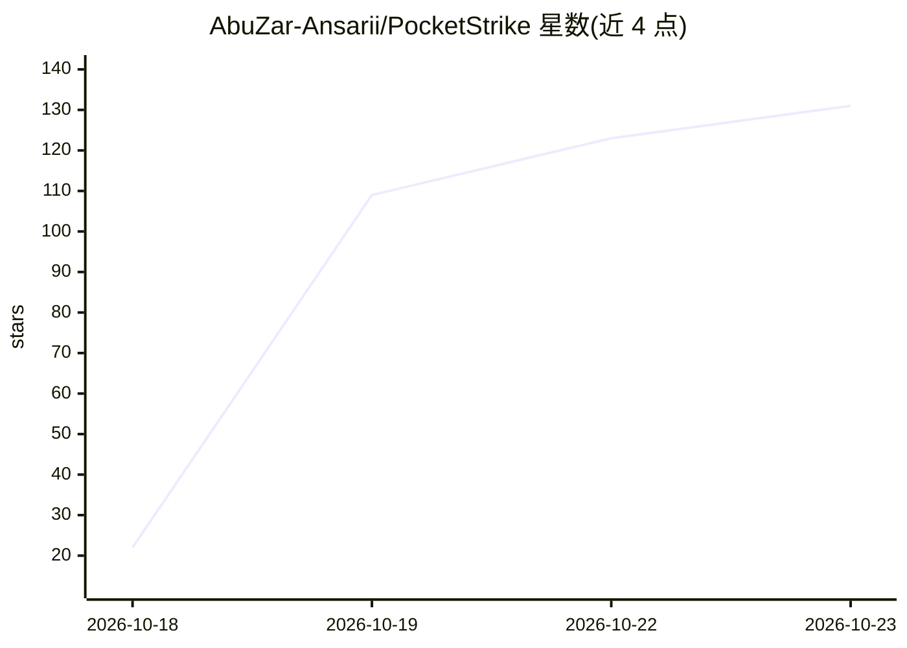

# AbuZar-Ansarii/PocketStrike

⭐ 131 · Dart · MIT · 推送 2026-08-27 · [GitHub](https://github.com/AbuZar-Ansarii/PocketStrike) · 个人维护

**Android 端离线 GGUF 推理与云 LLM 的移动 AI 工作站应用**

基于 Flutter 开发的 Android 应用：在手机上以 ARM NEON 多线程加速运行量化 GGUF 小模型（内置 SmolLM2、Llama 3.2、Qwen2.5、DeepSeek R1 Distill 等 1-tap 预设，从 HuggingFace 应用内下载权重），同时支持接入云端前沿 LLM；提供 ReAct 多步工具执行的 Agent 引擎、MCP 服务器市场（Streamable HTTP/SSE，内置 11+ 服务器）、跨会话自演化记忆（USER.md/MEMORY.md/SOUL.md）、FLUX 云端图像生成与 SD-Turbo 本地图像生成、Telegram 远程中继。不可逆文件操作提供确认安全门，API 密钥经硬件 AES-256 加密存储。需自行用 Flutter SDK 构建生成 APK，README 未提供预编译安装包。

## 筛选速览

| 维度 | 判定 | 备注 |
|---|---|---|
| AI 角色 | `ai-native` | 本体是模型或模型工具 |
| 许可风险 | `permissive` | MIT |
| 部署形态 | `None` |  |
| 模型依赖 | local-ok | 支持本地模型 |
| 硬件要求 | — | 无带数字的原话,不猜 |
| 安装摩擦 | `low` | 无编译、无系统依赖或容器化 |
| 成熟度 | — | 结构信号不足 |

## 能力要点

- ARM NEON 加速的端侧 GGUF 推理，零云端依赖
- ReAct Agent 引擎与 MCP 服务器市场（11+ 内置服务器）
- 跨会话自演化持久记忆文件系统
- 应用内从 HuggingFace 下载模型权重并显示 tok/s 实时吞吐

## 适用场景

- 在手机上离线运行量化小模型进行对话
- 通过 MCP 服务器与 ReAct 工具链执行多步任务
- 用自然语言命令生成 AI 图像（云端 FLUX / 本地 SD-Turbo）
- 经 Telegram 远程操控手机上的 AI 助手

## 场景标签

`AI 助手` `图像生成` · 领域:对话与助手

## 证据(README 行号)

> L3: > **Executive Multi-Provider & 100% Offline AI Workstation for Android & Mobile**
> L23: - ⚡ **100% Offline On-Device Native GGUF Inference**: Run state-of-the-art quantized SLMs locally on your phone usi
> L29: - 🤖 **Autonomous ReAct Agent Engine**: Multi-step tool execution with step-by-step reasoning logs, real-time status

## 星数曲线

2026-10-18 22 → 2026-10-23 131（+109）

---
*卡片 v1 · prompt 1.4 · 生成 2026-10-23 · 置信度 high · 依据 README sha `f0da6a113f26` · [字段定义](../../DATASET.md)*
