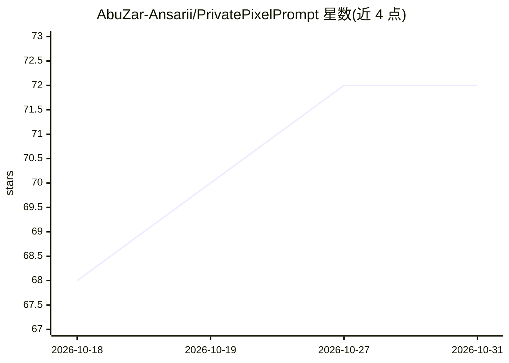

# AbuZar-Ansarii/PrivatePixelPrompt

⭐ 72 · HTML · MIT · 推送 2026-08-20 · [GitHub](https://github.com/AbuZar-Ansarii/PrivatePixelPrompt) · 个人维护

**USB/移动硬盘即插即用的完全离线本地 AI 多模态套件**

面向希望离线使用 AI 的个人用户，将 LLM 聊天（Ollama 运行 .gguf 模型如 LFM2.5 230M）、Stable Diffusion 图像生成（stable-diffusion.cpp）、Piper 文本转语音整合到单个可携带环境中，从 USB/SSD 直接运行，支持 Windows/macOS/Linux/Android(Termux)。采用便携 Python 与独立引擎二进制，模型下载一次后通过 Shared 卷跨平台复用；自带 HTTP 服务器提供 Web UI，可在局域网手机/平板访问。初始下载需联网，之后完全离线。

## 筛选速览

| 维度 | 判定 | 备注 |
|---|---|---|
| AI 角色 | `ai-native` | 本体是模型或模型工具 |
| 许可风险 | `permissive` | MIT |
| 部署形态 | `None` |  |
| 模型依赖 | local-ok | 支持本地模型 |
| 硬件要求 | — | 无带数字的原话,不猜 |
| 安装摩擦 | `low` | 无编译、无系统依赖或容器化 |
| 成熟度 | — | 结构信号不足 |

## 能力要点

- LLM 聊天+图像生成+TTS 三合一界面，模型与引擎全部本地运行
- 零依赖安装：随附便携 Python 与独立引擎二进制，无需系统权限
- Shared 卷架构：模型下载一次，跨 Windows/macOS/Linux/Android(Termux) 使用
- 自定义 HTTP 服务提供暗色 Web UI，支持局域网手机访问

## 适用场景

- 在 U 盘/移动 SSD 上携带一套离线 AI 工具，随时插机即用
- 无网络或隐私敏感环境下进行聊天、生图、语音合成
- 用手机或平板通过局域网访问电脑上的本地 AI

## 场景标签

`聊天机器人` `图像生成` `语音合成` · 领域:对话与助手

## 证据(README 行号)

> L3: **PortableLM** is a fully air-gapped, zero-dependency, plug-and-play local AI environment designed to run seamlessly
> L13: * **Multi-Modal AI Hub:** A single interface for **Text Chat (LLM)**, **Image Generation (Stable Diffusion)**, and 
> L25: ### 💬 Local Chat (LLM)
> L26: Powered by **Ollama**, run world-class models like Liquid AI LFM2.5 230M, Gemma 2, Llama 3, and Qwen entirely local

## 星数曲线

2026-10-18 68 → 2026-10-31 72（+4）

---
*卡片 v1 · prompt 1.4 · 生成 2026-10-24 · 置信度 high · 依据 README sha `e4f2f85b5103` · [字段定义](../../DATASET.md)*
