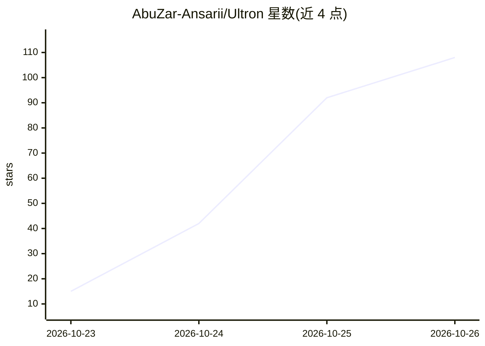

# AbuZar-Ansarii/Ultron

⭐ 108 · Python · 推送 2026-10-24 · [GitHub](https://github.com/AbuZar-Ansarii/Ultron) · 个人维护

**语音优先的自主桌面 AI 助手：用对话操控整台工作站**

以 MCU Ultron 为人设的实时语音桌面智能体：基于 Python 与 Gemini Live 会话构建，通过语音指令与 51 个自动发现的本地工具操控电脑，包括桌面/窗口/进程管理、鼠标键盘接管、终端命令执行、网络与端口安全审计、人脸识别哨兵等。附带本地 SQLite 知识图谱记忆（TF-IDF 余弦相似度 RAG）、OpenCV 手势控制、Home Assistant 智能灯光联动、情绪感知工作区编排与自我进化生成新工具机制。需配置 Gemini API key，从源码运行，支持 Windows/macOS/Linux。

## 筛选速览

| 维度 | 判定 | 备注 |
|---|---|---|
| AI 角色 | `ai-native` | 本体是模型或模型工具 |
| 许可风险 | `none` | — |
| 部署形态 | `library` | 以包/库形式分发 |
| 模型依赖 | locked-api |  |
| 硬件要求 | — | 无带数字的原话,不猜 |
| 安装摩擦 | `low` | 无编译、无系统依赖或容器化 |
| 成熟度 | — | 结构信号不足 |

## 能力要点

- 51 个自动发现的本地工具：桌面控制、Ghost Pilot 鼠键接管、终端自动化、网络审计
- 本地 SQLite 知识图谱记忆与语义 RAG 召回（L2 归一化 TF-IDF 余弦相似度）
- OpenCV 手势控制（30 FPS 手部追踪：唤醒、锁屏、切歌、音量）
- 自我进化机制：生成、编译并热加载新 Python 工具，无需重启

## 适用场景

- 用语音让 AI 助手代为操控电脑、打开工作区与执行自动化流程
- 对工作站做网络端口与安全审计、人脸识别哨兵监控
- 通过手势免触控操控媒体与锁定工作站

## 场景标签

`语音 Agent` `GUI 自动化` `AI 助手` `人脸识别` · 领域:效率与自动化

## 证据(README 行号)

> L14: > **Ultron AI** is a real-time, voice-first autonomous desktop intelligence that commands your computer from A to Z
> L115: ├── main.py                   # Master event loop, Gemini Live session & tool dispatcher

## 星数曲线

2026-10-23 15 → 2026-10-26 108（+93）

---
*卡片 v1 · prompt 1.4 · 生成 2026-10-24 · 置信度 high · 依据 README sha `afdfd4e06bb6` · [字段定义](../../DATASET.md)*
