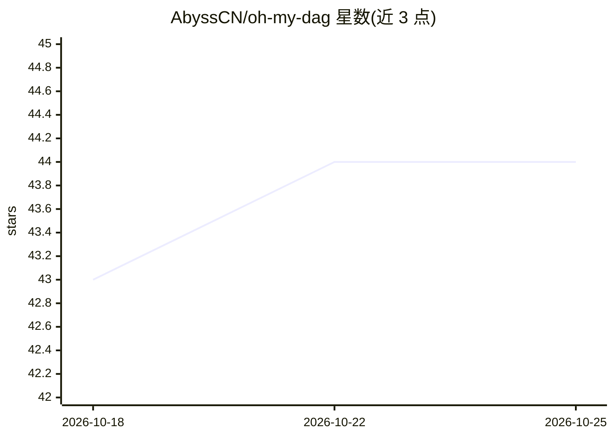

# AbyssCN/oh-my-dag

⭐ 44 · TypeScript · MIT · 推送 2026-10-11 · [GitHub](https://github.com/AbyssCN/oh-my-dag) · 个人维护 · 中文 README

**给编码 Agent 的 MCP 编排层：DAG 图驱动、跨模型族校验**

以 MCP server 与 CLI 形式运行在编码 Agent 之下的编排引擎：把工作单元组织成 zod 校验的类型化 DAG 图文件，每个节点可指定不同模型（18 个模型席位）；节点以退出码、写入集对账与产物门控判定完成，验收命令先经“考前测试”核验，另由不同模型族担任校验者。支持节点级检查点与断点续跑、无模型参与的检索（omd_web），内置 50 个 MCP 工具与 22 条管线技能，附带 6,818 个测试。通过 git clone + Bun 安装，未上架 npm。

## 筛选速览

| 维度 | 判定 | 备注 |
|---|---|---|
| AI 角色 | `ai-ecosystem` | LLM/agent 周边工具 |
| 许可风险 | `permissive` | MIT |
| 部署形态 | `None` |  |
| 模型依赖 | — | README 未给出锁定关系 |
| 硬件要求 | — | 无带数字的原话,不猜 |
| 安装摩擦 | `low` | 无编译、无系统依赖或容器化 |
| 成熟度 | — | 结构信号不足 |

## 能力要点

- 50 个 MCP 工具、13 个控制流原语、18 个模型席位、22 条内置管线
- 节点级完成判定：退出码 + 写入集对账 + 产物门控，验收命令先经两次反例测试
- 校验者使用与作者不同的模型族，失败则升级重排
- dag_resume 断点续跑，omd_web 检索环节零 LLM 参与

## 适用场景

- 现有编码 Agent 处理超出单次对话的大任务
- 需要外部化验收（退出码/跨模型校验）而非信任模型自述完成
- 按阶段分配不同价位/家族模型并控制成本

## 场景标签

`多智能体` `编码 Agent` `Agent 框架` · 领域:Agent 开发

## 证据(README 行号)

> L1: Where omd sits: your coding agent on top, omd underneath over MCP, then memory and models
> L3:  The orchestration layer under your coding agent.
> L33: After install, **`omd` is a CLI first, MCP server second**. The same `omd` binary runs every MCP

## 星数曲线

2026-10-18 43 → 2026-10-25 44（+1）

---
*卡片 v1 · prompt 1.4 · 生成 2026-10-25 · 置信度 high · 依据 README sha `ee284367ad88` · [字段定义](../../DATASET.md)*
