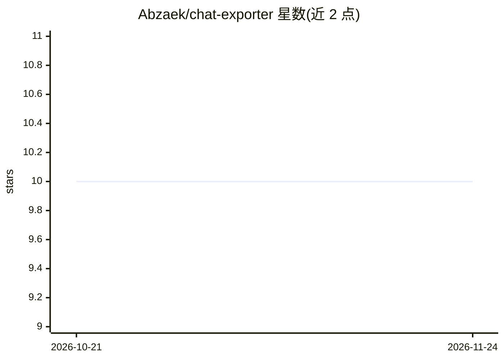

# Abzaek/chat-exporter

⭐ 10 · JavaScript · 推送 2026-03-16 · [GitHub](https://github.com/Abzaek/chat-exporter) · 个人维护

**导出 ChatGPT 对话为 Markdown，跨模型迁移上下文**

Chrome 扩展，将当前 chatgpt.com 会话一键导出为带标题、代码块、列表等格式的 Markdown 文件，用于在触达消息上限或上下文变差时将该文件上传至其他 LLM 继续对话。解析全部在浏览器本地完成，不向外部服务器发送数据。通过开发者模式加载未打包目录安装，支持 Chrome/Edge/Brave；仅支持从 ChatGPT 导出，格式与平台扩展（PDF/JSON、Claude/Gemini 导出）仍在规划中。

## 筛选速览

| 维度 | 判定 | 备注 |
|---|---|---|
| AI 角色 | `ai-enhanced` | 去掉 AI 部分产品仍成立 |
| 许可风险 | `none` | — |
| 部署形态 | `None` |  |
| 模型依赖 | — | README 未给出锁定关系 |
| 硬件要求 | — | 无带数字的原话,不猜 |
| 安装摩擦 | `low` | 无编译、无系统依赖或容器化 |
| 成熟度 | — | 结构信号不足 |

## 能力要点

- 一键导出活动会话为 .md 文件
- 保留标题、代码块语言标签、加粗、列表、引用格式
- 解析在浏览器本地完成，无外部数据传输
- Markdown 对语言模型 token 效率高，可直接上传恢复上下文

## 适用场景

- ChatGPT 消息达到上限后换用其他模型并保留上下文
- 长对话质量下降时携现有上下文在新会话重新开始
- 留存格式完整的对话记录为本地 Markdown 文件

## 场景标签

 · 领域:浏览器工具/LLM 工作流辅助

## 证据(README 行号)

> L3: A seamless Chrome extension to export your ChatGPT conversations into clean, readable Markdown (`.md`) files.
> L17: This extension solves this problem by generating a completely formatted `.md` file of your current conversation ins
> L23: - 🔒 **Privacy First:** All parsing is done locally in your browser. No data is sent to external servers.

## 星数曲线

2026-10-21 10 → 2026-11-24 10（+0）

---
*卡片 v1 · prompt 1.4 · 生成 2026-11-20 · 置信度 high · 依据 README sha `d170d8b312d9` · [字段定义](../../DATASET.md)*
