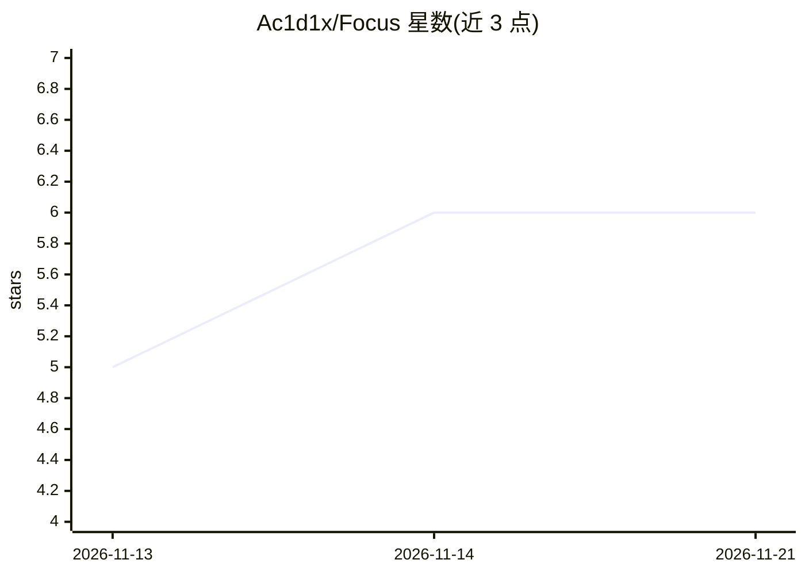

# Ac1d1x/Focus

⭐ 6 · Kotlin · MIT · 推送 2026-11-16 · [GitHub](https://github.com/Ac1d1x/Focus) · [官网](https://focus.x0.fan) · 个人维护 · 中文 README

**Android 私人 LLM 助理：聊天、记忆、设备控制与自动化**

Focus 是运行在 Android 8.0+ 上的私人助理应用，通过接入用户自选的模型提供商实现对话。功能覆盖记忆与用户资料跨对话保留、目标与提醒管理、RSS/Atom 订阅整理、悬浮助手与即圈即问、本地离线或云端语音识别，以及通过无障碍服务、Shizuku、Root 控制手机和通过 Rust 编写的 Bridge 操作电脑。支持主会话与旁聊并行、Cron/Webhook/设备事件触发器、MCP 服务器接入、脚本插件与 SKILL.md 技能，敏感操作有三种审批策略。提供 Releases 的 APK；自行编译需 JDK 21、Android SDK 与 Rust。

## 筛选速览

| 维度 | 判定 | 备注 |
|---|---|---|
| AI 角色 | `ai-native` | 本体是模型或模型工具 |
| 许可风险 | `permissive` | MIT |
| 部署形态 | `None` |  |
| 模型依赖 | locked-api |  |
| 硬件要求 | — | 无带数字的原话,不猜 |
| 安装摩擦 | `high` | 编译与系统依赖俱全 |
| 成熟度 | — | 结构信号不足 |

## 能力要点

- 无障碍/Shizuku/Root 三级手机控制，Bridge 可操作电脑文件与 shell
- 主会话+旁聊并行架构，可配置独立辅助模型
- Cron、Webhook、设备事件等多种自动触发器
- MCP 服务器接入、.focusplugin 插件与 SKILL.md 技能

## 适用场景

- 让助手记住我的事项并管理目标和提醒
- 用语音或悬浮窗在任意应用上直接提问
- 局域网内让手机助手操作电脑执行命令
- 定时/事件触发自动执行手机自动化任务

## 场景标签

`GUI 自动化` `语音 Agent` `语音识别` `AI 助手` · 领域:效率与自动化

## 证据(README 行号)

> L11: Focus 是跑在 Android 上的私人助理。它不只是聊天框，还能记住你的事、管理目标和提醒、读订阅和文件、控制手机，也可以通过 Bridge 操作电脑。
> L129: 内置预设包括 OpenAI、OpenRouter、DeepSeek、Anthropic 和 TypeSafe。为了简洁，默认不会添加这么多提供商。也可以自己添加任意兼容接口，填 Base URL、请求头、认证方式和模型 ID 即
> L143: 插件是一个后缀为 `.focusplugin` 的 APK。它和宿主同进程运行，可以直接使用 Focus 的 Compose、Koin 和数据层。

## 星数曲线

2026-11-13 5 → 2026-11-21 6（+1）

---
*卡片 v1 · prompt 1.4 · 生成 2026-11-20 · 置信度 high · 依据 README sha `5f1d219332d1` · [字段定义](../../DATASET.md)*
