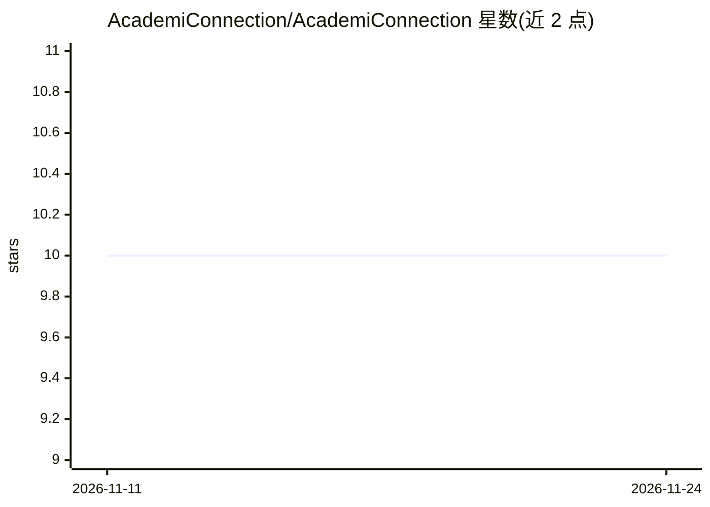

# AcademiConnection/AcademiConnection

⭐ 10 · Python · 推送 2026-11-20 · [GitHub](https://github.com/AcademiConnection/AcademiConnection) · 个人维护 · 中文 README

**给 AI Agent 用的学者人脉与课题组调研工具**

通过自然语言指令驱动的学术关系网络探索工具，为 AI Agent 提供三类能力：查询学者的合作者、导师、同门等关系（scholar-network），调研某研究领域的主要课题组分布（domain-survey），以及生成实验室画像含 PI、学生、论文、合作网络与毕业去向（lab-profile）。数据来源结合 Web 搜索与 OpenAlex API，输出结构化报告。README 以 Agent 提示词示例展示用法，未给出独立安装与运行说明，使用方式依赖接入 Agent 框架。

## 筛选速览

| 维度 | 判定 | 备注 |
|---|---|---|
| AI 角色 | `ai-native` | 本体是模型或模型工具 |
| 许可风险 | `none` | — |
| 部署形态 | `None` |  |
| 模型依赖 | — | README 未给出锁定关系 |
| 硬件要求 | — | 无带数字的原话,不猜 |
| 安装摩擦 | `low` | 无编译、无系统依赖或容器化 |
| 成熟度 | — | 结构信号不足 |

## 能力要点

- scholar-network：查询学者合作者、导师、同门等学术关系
- domain-survey：调研领域内主要课题组分布与代表工作
- lab-profile：生成实验室深度画像（PI、学生、论文、合作网络、毕业去向）
- 结合 Web 搜索与 OpenAlex API 输出结构化报告

## 适用场景

- 帮我查某位教授的学术合作网络
- 调研某研究领域有哪些主要课题组
- 了解某个实验室的团队构成与毕业去向

## 场景标签

`科研工具` · 领域:学习与行业

## 证据(README 行号)

> L3: 面向 AI Agent 的学术关系网络探索工具。通过自然语言指令驱动，自动完成学者人脉查询、领域课题组调研、实验室深度画像等任务，结合 Web 搜索与 OpenAlex API 输出结构化报告。
> L7: - **scholar-network** — 查询单个学者的合作者、导师、同门等学术关系
> L9: - **lab-profile** — 深度画像一个实验室：PI、学生、论文、合作网络、毕业去向

## 星数曲线

2026-11-11 10 → 2026-11-24 10（+0）

---
*卡片 v1 · prompt 1.4 · 生成 2026-11-20 · 置信度 mid · 依据 README sha `ab17a7024278` · [字段定义](../../DATASET.md)*
