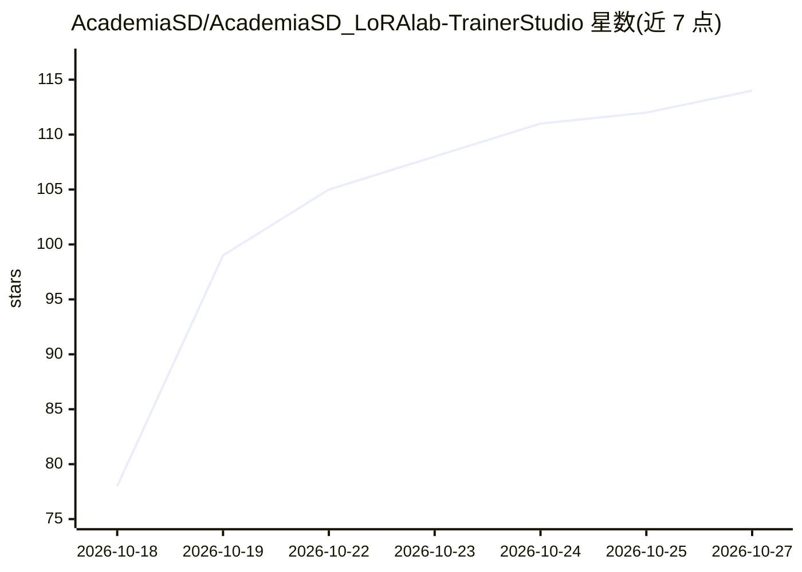

# AcademiaSD/AcademiaSD_LoRAlab-TrainerStudio

⭐ 114 · Python · MIT · 推送 2026-10-26 · [GitHub](https://github.com/AcademiaSD/AcademiaSD_LoRAlab-TrainerStudio) · 组织维护

**多模型 LoRA 训练工作台：消费级 GPU 上训练图像/视频模型 LoRA**

聚合 AcademiaSD 全系 LoRA 训练器的桌面工作台：以 NF4 4-bit 量化加载模型，文本编码器与 VAE 仅在 pre-cache 阶段运行一次，支持 Qwen-Image、FLUX.2/FLUX.3、Krea 2、SDXL（Pony/Illustrious/NoobAI）、LTX-2.3、MiniMax-H3 等十余种图像与视频模型的 LoRA 及编辑型 LoRA 训练，最低显存需求 4–8 GB。各训练器共用统一 Web 界面：数据集管理、自动打标、实时预览、断点续训与一键导出 ComfyUI，支持局域网远程访问与 RunPod 云端部署。通过 .bat/.sh 脚本一键安装，Windows/Linux 可用，AMD 为实验性支持。

## 筛选速览

| 维度 | 判定 | 备注 |
|---|---|---|
| AI 角色 | `ai-ecosystem` | LLM/agent 周边工具 |
| 许可风险 | `permissive` | MIT |
| 部署形态 | `desktop` | 安装包/桌面程序 |
| 模型依赖 | — | README 未给出锁定关系 |
| 硬件要求 | — | 无带数字的原话,不猜 |
| 安装摩擦 | `medium` | 含编译或系统依赖之一 |
| 成熟度 | `idea` | |

## 能力要点

- 统一启动器管理十余个图像/视频模型的 LoRA 训练器
- NF4 量化加载 + 文本编码器/VAE 预缓存，最低 4 GB 显存可训
- 数据集管理、自动打标、实时预览、精确步数续训、一键导出 ComfyUI
- 支持局域网远程上传/下载与 RunPod 云端模板

## 适用场景

- 在 4–12 GB 显存的家用 GPU 上为 Qwen-Image、FLUX 等 LoRA
- 训练角色、物体、风格及前后对比的编辑型 LoRA
- 从浏览器在局域网其他设备上传数据集并下载训练结果

## 场景标签

`微调` · 领域:训练与推理

## 证据(README 行号)

> L28: **AcademiaSD LoRAlab Trainer Studio** brings together all the AcademiaSD LoRAlab trainers. Each model is loaded in 
> L32: |Trainer|Trains|Minimum VRAM|

## 星数曲线

2026-10-18 78 → 2026-10-27 114（+36）

---
*卡片 v1 · prompt 1.4 · 生成 2026-10-23 · 置信度 high · 依据 README sha `ab605b561eec` · [字段定义](../../DATASET.md)*
