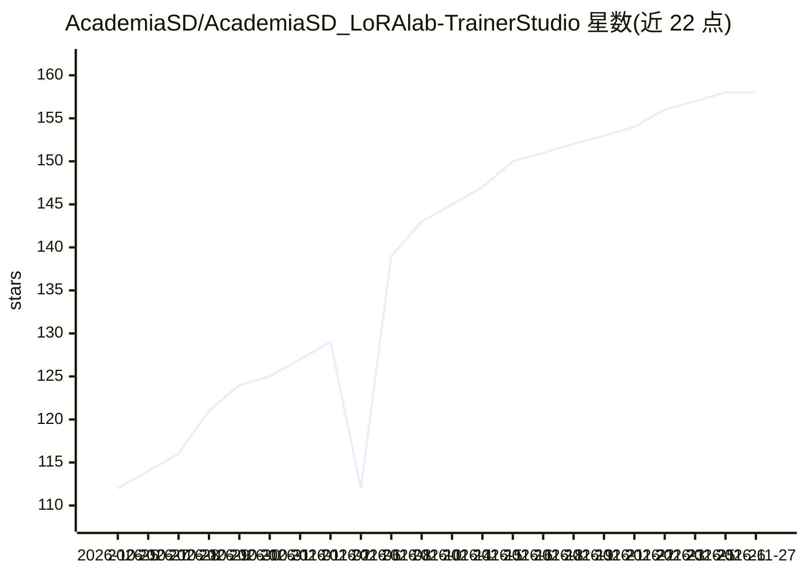

# AcademiaSD/AcademiaSD_LoRAlab-TrainerStudio

⭐ 158 · Python · MIT · 推送 2026-11-26 · [GitHub](https://github.com/AcademiaSD/AcademiaSD_LoRAlab-TrainerStudio) · 个人维护

**低显存 NVIDIA GPU 上的多模型 LoRA 训练工作台**

面向消费级显卡的 LoRA 训练整合工具：一次安装、一个启动器，以 NF4 量化方式在 4–8 GB VRAM 上训练 Qwen-Image、FLUX 系列、Anima、SDXL、LTX、MiniMax-H3 等十多个图像与视频模型的 LoRA/LoKr/DoRA。机制上提供 block swap 与 VRAM Profile 控制显存占用，内置数据集分析器（重复/模糊图、缺触发词检测）、BiRefNet 遮罩损失、输出保留、自动最佳 checkpoint 评选、XY 网格预览，训练产物可在 ComfyUI 加载。支持 Windows、Linux 与 RunPod，老显卡可切 FP16。

## 筛选速览

| 维度 | 判定 | 备注 |
|---|---|---|
| AI 角色 | `ai-ecosystem` | LLM/agent 周边工具 |
| 许可风险 | `permissive` | MIT |
| 部署形态 | `None` |  |
| 模型依赖 | — | README 未给出锁定关系 |
| 硬件要求 | `gpu-8g` | |
| 安装摩擦 | `medium` | 含编译或系统依赖之一 |
| 成熟度 | — | 结构信号不足 |

## 能力要点

- NF4 量化 + block swap + VRAM Profile，4–8 GB 显卡可训练
- 数据集分析器检测重复/模糊图、缺触发词与人脸混入
- 训练结束自动用同提示词评分并复制最佳 checkpoint
- 17 个训练器支持 DoRA 与 Auto/BF16/FP16 精度选择

## 适用场景

- 在 8 GB 显卡上训练角色或画风 LoRA
- 训练能在 ComfyUI 中直接加载的 LoRA/DoRA 文件
- 用内置数据集分析器清理训练图集
- 在 RunPod 上运行训练环境

## 场景标签

`微调` `模型量化` · 领域:训练与推理

## 证据(README 行号)

> L13: - MAJOR UPDATE **Masked loss in every image trainer** — BiRefNet (MIT, ~0.2 GB) cuts out the subject of every image
> L18: - MAJOR UPDATE **Optimizer selector, with Prodigy** — choose AdamW, AdamW 8-bit, Prodigy or Adafactor above the LR 
> L30: - **Krea 2 from 8 GB of VRAM** — the block swap and **VRAM Profile** of FLUX.1 and Klein 9B. At 1024² Krea 2 peaked

## 星数曲线

2026-10-25 112 → 2026-11-27 158（+46）

---
*卡片 v1 · prompt 1.4 · 生成 2026-11-27 · 置信度 high · 依据 README sha `629feefd534f` · [字段定义](../../DATASET.md)*
