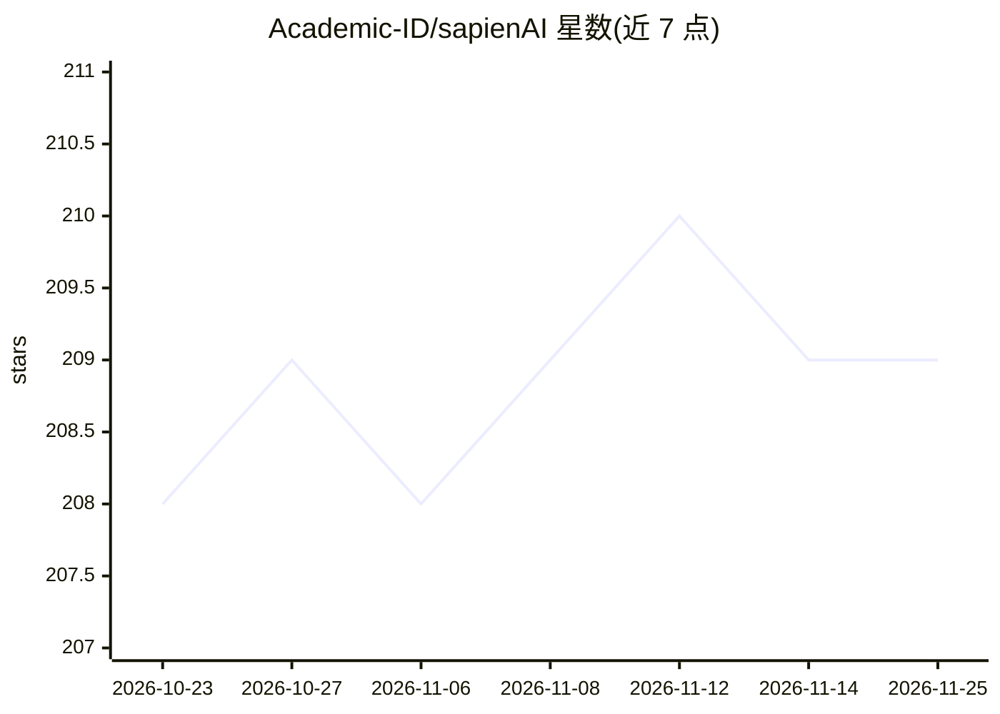

# Academic-ID/sapienAI

⭐ 209 · Shell · NOASSERTION · 推送 2026-11-20 · [GitHub](https://github.com/Academic-ID/sapienAI) · [官网](https://academicid.io/) · 组织维护

**面向科研人员的自托管 AI 研究工作区与学术聊天应用**

自托管的学术聊天机器人与研究工作区，将 OpenAI、Anthropic、Google 及本地 Ollama 模型统一到一个安全界面。功能包括实时语音聊天、100% 本地数据存储、学术论文集成、语义搜索与专用研究空间；研究空间内置支持 Markdown、Typst 和 LaTeX 的编辑器，可上传文档由 AI 读取、摘要与问答，并基于上传文献自动生成与导出 Word/Excel 格式的文献综述。安装需 Docker 与 Docker Compose，至少配置一个 AI 提供商的 API key；当前处于 beta 阶段。

## 筛选速览

| 维度 | 判定 | 备注 |
|---|---|---|
| AI 角色 | `ai-native` | 本体是模型或模型工具 |
| 许可风险 | `none` | NOASSERTION |
| 部署形态 | `self-host` | docker 或自建部署 |
| 模型依赖 | local-ok | 支持本地模型 |
| 硬件要求 | — | 无带数字的原话,不猜 |
| 安装摩擦 | `low` | 无编译、无系统依赖或容器化 |
| 成熟度 | `idea` | |

## 能力要点

- 统一聊天界面：切换 OpenAI、Anthropic、Google 与本地 Ollama 模型
- 实时语音聊天与 100% 本地数据存储
- 支持 Markdown/Typst/LaTeX 的集成编辑器与研究空间
- 可连接 Zotero 文献库的语义搜索

## 适用场景

- 在一个界面与多家 AI 模型对话完成学术写作
- 上传论文与笔记让 AI 摘要和答疑
- 基于自建文献库自动生成文献综述
- 在本地部署中保持消息与文件私有

## 场景标签

`聊天机器人` `科研工具` `语义搜索` `文档问答` · 领域:对话与助手

## 证据(README 行号)

> L23: SapienAI is a self-hosted academic chatbot and research workspace. It unifies
> L26: 100% local data storage, academic paper integration, semantic search, and
> L62:  assistance as you need. Full support for **Markdown**, **Typst** and

## 星数曲线

2026-10-23 208 → 2026-11-25 209（+1）

---
*卡片 v1 · prompt 1.4 · 生成 2026-11-25 · 置信度 high · 依据 README sha `776e9271ce9c` · [字段定义](../../DATASET.md)*
