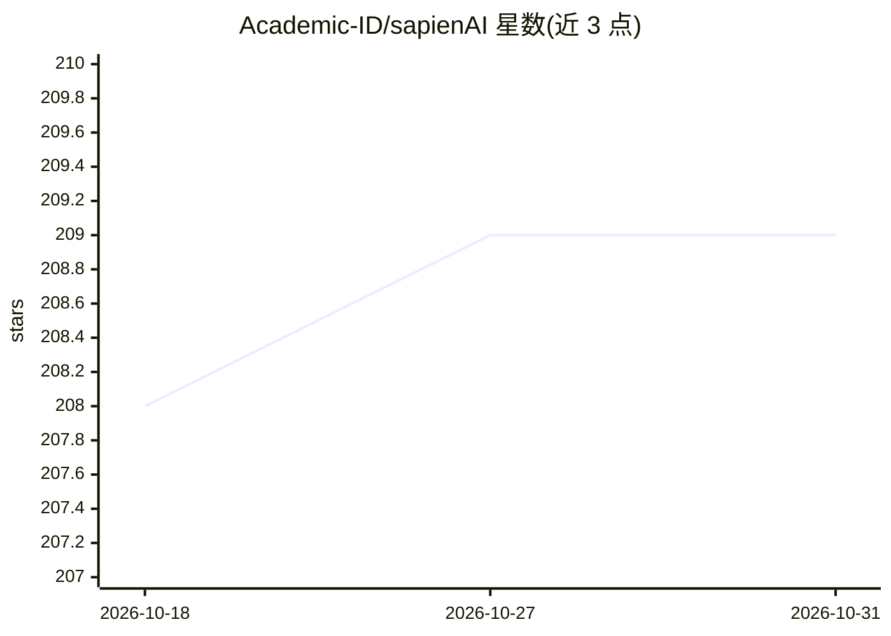

# Academic-ID/sapienAI

⭐ 209 · Shell · NOASSERTION · 推送 2026-06-13 · [GitHub](https://github.com/Academic-ID/sapienAI) · [官网](https://academicid.io/) · 组织维护

**自托管的学术聊天机器人与科研写作工作台**

面向学术研究者的自托管 AI 工作台：将 OpenAI、Anthropic、Google 的云端模型与本地 Ollama 模型统一到一个界面中，支持实时语音对话、语义搜索、Zotero 集成与学术论文接地问答。提供 Markdown/Typst/LaTeX 编辑器的研究空间，AI 可读取、总结上传文档并生成文献综述（导出 Word/Excel）。所有数据本地存储。通过 Docker Compose 部署，需至少配置一个 API 提供商密钥；项目处于 beta 阶段，文档中注明可能遇到 bug。

## 筛选速览

| 维度 | 判定 | 备注 |
|---|---|---|
| AI 角色 | `ai-native` | 本体是模型或模型工具 |
| 许可风险 | `none` | NOASSERTION |
| 部署形态 | `self-host` | docker 或自建部署 |
| 模型依赖 | local-ok | 支持本地模型 |
| 硬件要求 | — | 无带数字的原话,不猜 |
| 安装摩擦 | `low` | 无编译、无系统依赖或容器化 |
| 成熟度 | `idea` | |

## 能力要点

- 统一接入 OpenAI/Anthropic/Google 云端模型与本地 Ollama 模型
- 支持 Markdown/Typst/LaTeX 的集成编辑器与研究空间
- 基于学术论文接地的问答与语义搜索（含 Zotero 集成）
- AI 生成文献综述并导出 Word/Excel 格式

## 适用场景

- 在一个自托管界面中与多家模型进行学术对话
- 撰写论文时获得 AI 辅助编辑与文献问答
- 对上传文档和个人知识库做语义搜索

## 场景标签

`聊天机器人` `科研工具` `语义搜索` `AI 写作` · 领域:对话与助手

## 证据(README 行号)

> L18: SapienAI is a self-hosted academic chatbot and research workspace. It unifies
> L20: models** into a single, secure interface. Features include realtime audio chat,
> L39: - **🧠 Multi-Provider Support:** Seamlessly switch between the top models from

## 星数曲线

2026-10-18 208 → 2026-10-31 209（+1）

---
*卡片 v1 · prompt 1.4 · 生成 2026-10-22 · 置信度 high · 依据 README sha `4cc1ed9ab213` · [字段定义](../../DATASET.md)*
