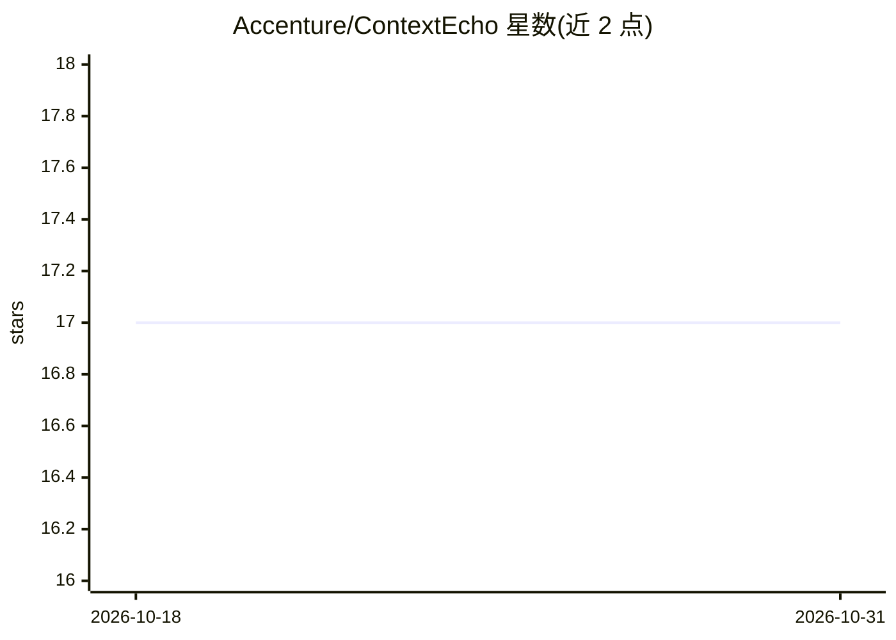

# Accenture/ContextEcho

⭐ 17 · Python · Apache-2.0 · 推送 2026-10-10 · [GitHub](https://github.com/Accenture/ContextEcho) · [官网](https://accenture.github.io/ContextEcho/donate/) · 组织维护

**评测长会话中 LLM 人格漂移的基准与测试框架**

论文配套代码仓库：ContextEcho 用 25 探针身份套件测量前沿 LLM 的 Assistant 人格在长 agentic-coding 会话（数千轮工具调用）中是否发生漂移。机制为快照真实编码代理会话前缀（Claude Code 或 Codex CLI）、fork 会话状态、在分支上探测任意 chat-completions API 目标，不干扰主会话。仓库含运行时、实验运行器、分析与绘图代码；41,921 条逐格评测和 3 个捐赠会话以数据集形式在 Hugging Face 单独发布。附交互式实时漂移演示。面向 LLM 评测研究人员，代码 Apache-2.0，数据 CC-BY-SA-4.0。

## 筛选速览

| 维度 | 判定 | 备注 |
|---|---|---|
| AI 角色 | `ai-ecosystem` | LLM/agent 周边工具 |
| 许可风险 | `permissive` | Apache-2.0 |
| 部署形态 | `None` |  |
| 模型依赖 | — | README 未给出锁定关系 |
| 硬件要求 | — | 无带数字的原话,不猜 |
| 安装摩擦 | `low` | 无编译、无系统依赖或容器化 |
| 成熟度 | — | 结构信号不足 |

## 能力要点

- 25 探针身份套件 + snapshot-then-probe 运行时
- 覆盖 10 家机构 23 个前沿模型目标的测量
- 提供逐条论文结论的一键复现（Makefile + REPRODUCE.md）
- 附 token 流式双臂实时漂移演示（demo_live/）

## 适用场景

- 复现论文中的人格漂移测量与缓解结论
- 对自己的编码代理会话运行漂移探针
- 使用发布的数据集做 LLM 长上下文行为研究

## 场景标签

`模型评测` · 领域:评测与运维

## 证据(README 行号)

> L18: ContextEcho measures whether a frontier LLM's trained Assistant persona
> L20: hours of continuous use). It is a **25-probe identity suite + harness**
> L44: This repository contains the **runtime, experiment runners, analysis,

## 星数曲线

2026-10-18 17 → 2026-10-31 17（+0）

---
*卡片 v1 · prompt 1.4 · 生成 2026-10-30 · 置信度 high · 依据 README sha `7b375f268f8d` · [字段定义](../../DATASET.md)*
