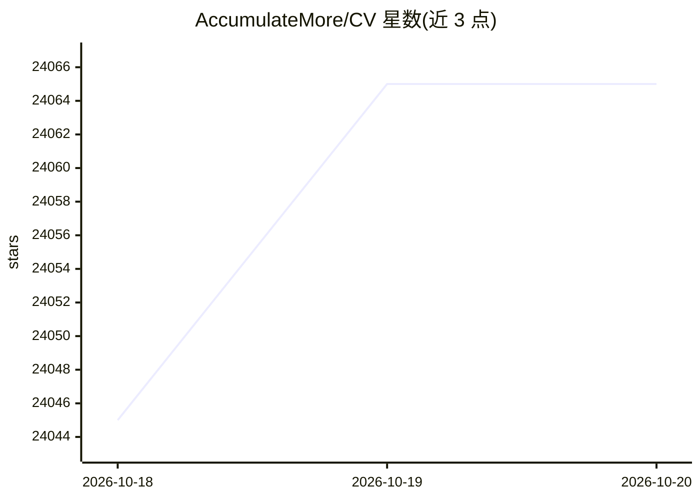

# AccumulateMore/CV

⭐ 24,065 · Jupyter Notebook · 推送 2026-09-20 · [GitHub](https://github.com/AccumulateMore/CV) · 个人维护 · 中文 README

**中文自学者的深度学习与大模型课程笔记合集**

以 Jupyter Notebook 形式整理的中文深度学习学习笔记，覆盖四个视频课程系列：土堆 Pytorch（100-122 号笔记）、李沐动手学深度学习（200-268）、吴恩达深度学习（300-354）、大飞大模型 Agent（400-409），并预告另一 Agent 系列待上线。附百度网盘分享的数据集、在线观看图片/公式显示问题的说明、Jupyter Notebook 目录插件建议及自学交流群。面向中文自学入门者，仓库本身不含代码工程或安装流程。

## 筛选速览

| 维度 | 判定 | 备注 |
|---|---|---|
| AI 角色 | `ai-knowledge` | 知识聚合/清单类 |
| 许可风险 | `none` | — |
| 部署形态 | `None` |  |
| 模型依赖 | — | README 未给出锁定关系 |
| 硬件要求 | — | 无带数字的原话,不猜 |
| 安装摩擦 | `low` | 无编译、无系统依赖或容器化 |
| 成熟度 | — | 结构信号不足 |

## 动量与使用信号

- 维护:`active` — 距上次 push 28.3 天,年发版 0,1 位贡献者
- 涨星:近 1 天 **+11**(自 20261016 起算)

## 能力要点

- 四套视频课程的中文笔记（PyTorch、李沐、吴恩达、大模型 Agent）
- 以 Jupyter Notebook 组织，可在线阅读或下载本地查看
- 附百度网盘数据集分享与交流群入口

## 适用场景

- 跟着土堆视频学 PyTorch 时对照笔记复习
- 通过李沐/吴恩达课程笔记自学深度学习
- 入门大模型 Agent 概念的中文资料查阅

## 场景标签

`教程课程` · 领域:学习与行业

## 证据(README 行号)

> L1: # 超级全面的 深度学习 笔记（包含CV、NLP、大模型、Agent）
> L5: Pytorch 视频讲解【主讲人：土堆】【对应笔记：100-122】
> L17: 大模型Agent 视频讲解【主讲人：大飞】【对应笔记：400-409】

## 星数曲线

2026-10-18 24,045 → 2026-10-20 24,065（+20）

---
*卡片 v1 · prompt 1.4 · 生成 2026-10-18 · 置信度 high · 依据 README sha `fb1c55b890a1` · [字段定义](../../DATASET.md)*
