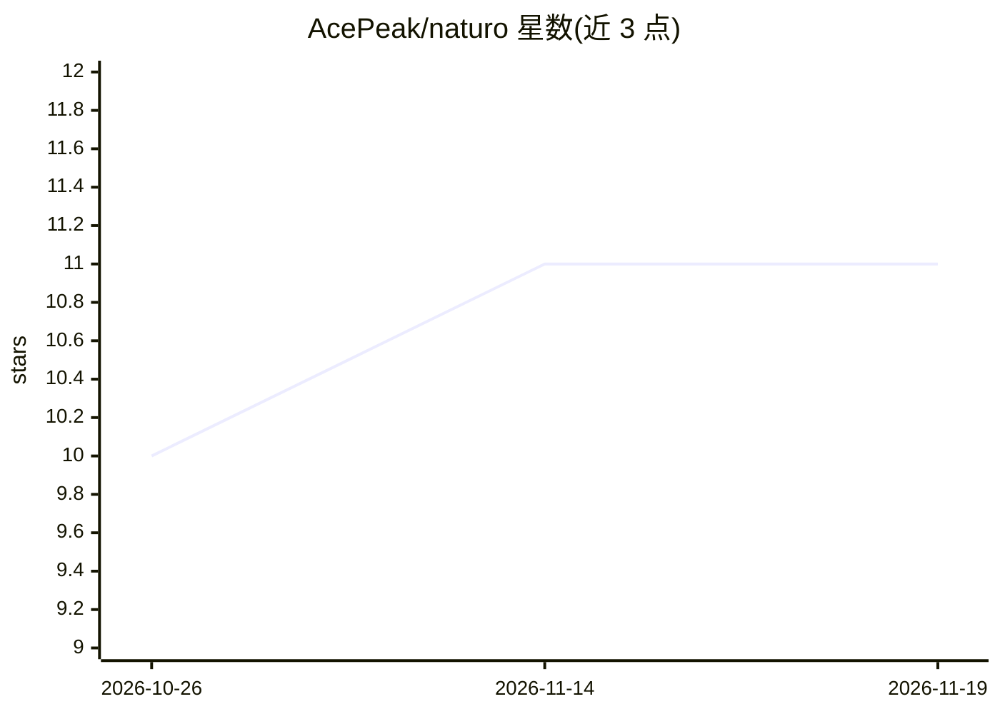

# AcePeak/naturo

⭐ 11 · Python · MIT · 推送 2026-10-26 · [GitHub](https://github.com/AcePeak/naturo) · 个人维护 · 中文 README

**给 AI Agent 用的 Windows 桌面自动化引擎（MCP 服务器）**

面向 Windows 10/11 的桌面自动化引擎，提供屏幕截图、UIA/MSAA/IA2/JAB 可访问性树遍历、元素查找、点击输入、窗口与应用管理、对话框处理、虚拟桌面及基于 CDP 的浏览器自动化等能力，通过 CLI、Python SDK 与内置 MCP 服务器（60+ 工具）暴露给 Claude Desktop/Code、VS Code、Cursor、Windsurf 等 agent 客户端。级联识别按 UIA→CDP→AI Vision 顺序融合，AI Vision 需设置 ANTHROPIC_API_KEY 或 OPENAI_API_KEY。macOS/Linux 支持尚在开发中。

## 筛选速览

| 维度 | 判定 | 备注 |
|---|---|---|
| AI 角色 | `ai-enhanced` | 去掉 AI 部分产品仍成立 |
| 许可风险 | `permissive` | MIT |
| 部署形态 | `desktop` | 安装包/桌面程序 |
| 模型依赖 | — | README 未给出锁定关系 |
| 硬件要求 | — | 无带数字的原话,不猜 |
| 安装摩擦 | `low` | 无编译、无系统依赖或容器化 |
| 成熟度 | — | 结构信号不足 |

## 能力要点

- UIA + MSAA/IA2 + Java Access Bridge + CDP + AI Vision 多源级联识别
- 内置 MCP 服务器，提供 60+ 工具，支持 stdio/SSE/Streamable HTTP 传输
- 覆盖钉钉/飞书/企业微信/WPS 等 CEF/自绘框架应用
- 同一引擎提供 CLI、Python SDK 与 MCP 三种使用方式

## 适用场景

- 让 Claude 等 agent 操作 Windows 桌面应用完成表单填写与文件保存
- 自动化 Electron/CEF 应用（如飞书）的界面读取与操作
- 通过 CDP 做浏览器页面的导航、取值与截图
- 录制用户操作并回放为 Python/Bash 脚本

## 场景标签

`GUI 自动化` `浏览器自动化` · 领域:效率与自动化

## 证据(README 行号)

> L3: > See, click, type, capture. Desktop automation core only.
> L73: Naturo includes a built-in MCP server with 60+ tools for AI agent integration.

## 星数曲线

2026-10-26 10 → 2026-11-19 11（+1）

---
*卡片 v1 · prompt 1.4 · 生成 2026-11-19 · 置信度 high · 依据 README sha `4aea61ccf8b8` · [字段定义](../../DATASET.md)*
