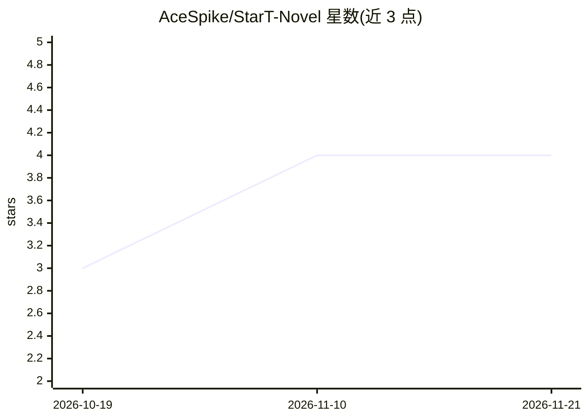

# AceSpike/StarT-Novel

⭐ 4 · TypeScript · GPL-3.0 · 推送 2026-10-08 · [GitHub](https://github.com/AceSpike/StarT-Novel) · [官网](https://acespike.github.io/StarT-Novel/) · 个人维护 · 中文 README

**本地运行的 AI 长篇中文网文创作桌面应用**

基于 Electron 的桌面应用，覆盖网文创作全流程：题材雷达联网搜索起点、晋江、番茄榜单找上升题材；从题材或构思生成书名、大纲等设定卡片；分卷细化章纲后逐章写作，每章自检并维护故事记忆防止前后矛盾；三位审稿员（AI 痕迹、逻辑、读者体验）按卷通读加逐章细审；可选接入裁判复核意见并打分；支持导出投稿版 Word、导入已有作品、按版本回退。用户自带 API Key，无服务器，书稿与 Key 本地保存。仅中文界面。

## 筛选速览

| 维度 | 判定 | 备注 |
|---|---|---|
| AI 角色 | `ai-native` | 本体是模型或模型工具 |
| 许可风险 | `viral` | GPL-3.0 |
| 部署形态 | `desktop` | 安装包/桌面程序 |
| 模型依赖 | — | README 未给出锁定关系 |
| 硬件要求 | — | 无带数字的原话,不猜 |
| 安装摩擦 | `low` | 无编译、无系统依赖或容器化 |
| 成熟度 | — | 结构信号不足 |

## 能力要点

- 题材雷达联网搜索平台榜单并附来源链接
- 逐章写作自检与故事记忆（人物状态、伏笔、已确立事实）
- 三位审稿员按卷通读找跨章问题，小问题自动修改
- 导出投稿版/存档版 Word，可导入 .txt/.docx/.md 继续创作

## 适用场景

- 用 AI 流水线从找题材到成稿写长篇网文
- 对已写好的书稿进行 AI 审稿与修改
- 多台电脑通过 OneDrive 共用书稿

## 场景标签

`AI 写作` · 领域:内容生成

## 证据(README 行号)

> L3: 一个在自己电脑上运行的 AI 长篇小说创作工具：从找题材、定设定，到分章写作、三位审稿员审稿，再到导出 Word，一条流水线完成。
> L61: 1. **设置 → 模型**：填入你自己的 API Key，点"测试连接"。支持 Gemini、Claude、OpenAI、DeepSeek、通义千问、Kimi、豆包，以及任何兼容 OpenAI / Anthropic 接口格式的

## 星数曲线

2026-10-19 3 → 2026-11-21 4（+1）

---
*卡片 v1 · prompt 1.4 · 生成 2026-11-21 · 置信度 high · 依据 README sha `c80fcbe574a3` · [字段定义](../../DATASET.md)*
