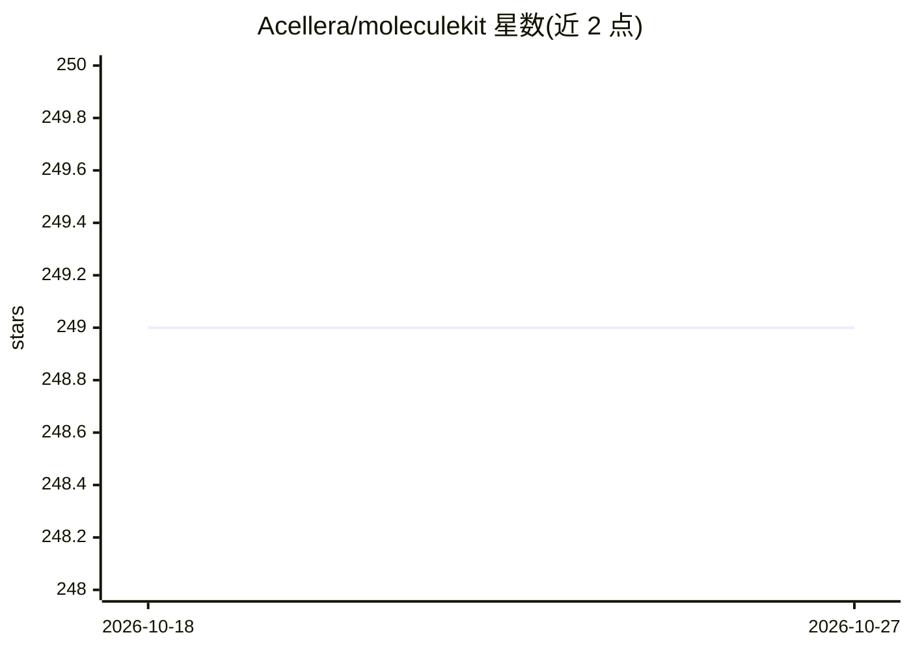

# Acellera/moleculekit

⭐ 249 · Python · NOASSERTION · 推送 2026-10-26 · [GitHub](https://github.com/Acellera/moleculekit) · 组织维护

**分子操作 Python 库：读取、查看与处理蛋白质等分子结构**

由 Acellera 维护的分子操作库，提供 Molecule 类加载分子体系（如 PDB 结构 3ptb）并在 ipython 中查看与操作，API 文档单独发布于 Acellera 软件站点。通过 pip 或 conda 安装，内含需编译的 C++/Cython 扩展（开发模式下需 setup.py build_ext --inplace），并支持构建 WebAssembly 版本。项目可追溯至 HTMD 高通量分子动力学论文（JCTC 2016），面向计算化学与药物发现研究者。README 未展开具体机器学习功能细节。

## 筛选速览

| 维度 | 判定 | 备注 |
|---|---|---|
| AI 角色 | `ai-enhanced` | 去掉 AI 部分产品仍成立 |
| 许可风险 | `none` | NOASSERTION |
| 部署形态 | `library` | 以包/库形式分发 |
| 模型依赖 | — | README 未给出锁定关系 |
| 硬件要求 | — | 无带数字的原话,不猜 |
| 安装摩擦 | `medium` | 含编译或系统依赖之一 |
| 成熟度 | — | 结构信号不足 |

## 能力要点

- Molecule 类加载并查看分子结构（示例：3ptb）
- 含 C++/Cython 扩展，支持源码内编译
- 支持构建 WebAssembly（pyodide）版本
- 有正式发表论文（HTMD, JCTC 2016）可引用

## 适用场景

- 在 Python/ipython 中加载与查看蛋白质等分子结构
- 作为分子建模与模拟工作流的基础操作库
- 构建面向 WebAssembly 的分子相关 Web 应用

## 场景标签

 · 领域:计算化学/分子建模

## 证据(README 行号)

> L5: A molecule manipulation library
> L40: mol = Molecule('3ptb')
> L86: Stefan Doerr, Matthew J. Harvey, Frank Noé, and Gianni De Fabritiis.

## 星数曲线

2026-10-18 249 → 2026-10-27 249（+0）

---
*卡片 v1 · prompt 1.4 · 生成 2026-10-22 · 置信度 mid · 依据 README sha `92580c233f34` · [字段定义](../../DATASET.md)*
