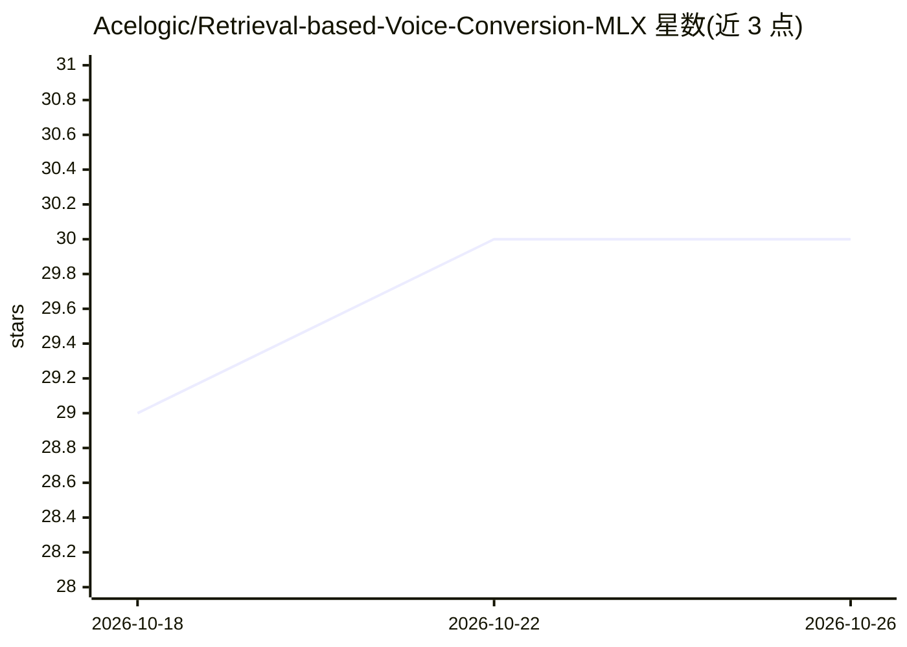

# Acelogic/Retrieval-based-Voice-Conversion-MLX

⭐ 30 · Python · 推送 2026-03-05 · [GitHub](https://github.com/Acelogic/Retrieval-based-Voice-Conversion-MLX) · 个人维护

**Apple Silicon 上的 RVC 语音转换 MLX 实现，含 Swift 原生版**

基于 Applio 分叉的检索式语音转换（RVC）纯 MLX 实现，面向 Apple Silicon 用户：完成 HuBERT→TextEncoder→Flow→Generator 全推理管线与 RMVPE 音高检测，附 iOS/macOS 的 Swift MLX 原生实现（Metal GPU 加速、FAISS IVFFlat、.pth 转 .safetensors）。README 以基准测试为主体：Python MLX 相对 PyTorch MPS 的推理时间、实时率、内存与频谱相关性（0.986）对比，Swift 版平均一致性 91.8%。基准在 MacBook Pro M3 Max（128GB RAM）上测得。限制：面向 Apple Silicon 平台，未提供安装命令与模型权重说明。

## 筛选速览

| 维度 | 判定 | 备注 |
|---|---|---|
| AI 角色 | `ai-native` | 本体是模型或模型工具 |
| 许可风险 | `none` | — |
| 部署形态 | `None` |  |
| 模型依赖 | — | README 未给出锁定关系 |
| 硬件要求 | — | 无带数字的原话,不猜 |
| 安装摩擦 | `low` | 无编译、无系统依赖或容器化 |
| 成熟度 | — | 结构信号不足 |

## 能力要点

- Python MLX 全管线推理，与 PyTorch 输出频谱相关性 0.986
- Swift MLX 原生实现（iOS/macOS），平均一致性 91.8%
- 支持 RMVPE/FCPE/Crepe/Crepe-Tiny 音高提取与 FAISS IVFFlat 索引
- 设备端 .pth → .safetensors 模型转换

## 适用场景

- 在 Mac 上本地运行 RVC 语音转换推理
- 将 RVC 能力以 Swift 原生形式集成到 iOS/macOS 应用
- 对比 MLX 与 PyTorch MPS 在 Apple Silicon 上的推理性能

## 场景标签

`语音合成` · 领域:内容生成

## 证据(README 行号)

> L3: A pure MLX implementation of RVC for Apple Silicon, delivering **8.71x faster** inference than PyTorch MPS.
> L127: - Full RVC pipeline: HuBERT → TextEncoder → Flow → Generator

## 星数曲线

2026-10-18 29 → 2026-10-26 30（+1）

---
*卡片 v1 · prompt 1.4 · 生成 2026-10-26 · 置信度 high · 依据 README sha `e160b7099945` · [字段定义](../../DATASET.md)*
