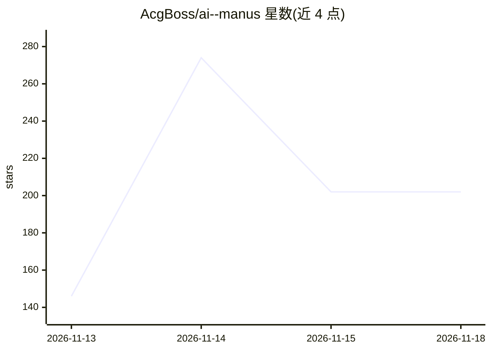

# AcgBoss/ai--manus

⭐ 202 · Apache-2.0 · 推送 2026-11-17 · [GitHub](https://github.com/AcgBoss/ai--manus) · 个人维护 · 中文 README

**自主 AI Agent：代替用户执行代码与控制浏览器完成任务**

README 以功能介绍为主：Manus 定位为面向家庭、学习与轻量工作场景的自主 AI Agent，可代替用户编写并执行脚本、控制浏览器（导航网页、填写表单、采集信息）并执行多步骤任务。描述中提及沙箱环境内运行多种工具与操作，面向无需编程背景的普通用户。README 未提供安装命令、技术架构或模型接入方式的说明，仅给出一份软硬件兼容性表格（最低 4GB 内存、双核 CPU）与使用步骤建议。

## 筛选速览

| 维度 | 判定 | 备注 |
|---|---|---|
| AI 角色 | `ai-native` | 本体是模型或模型工具 |
| 许可风险 | `permissive` | Apache-2.0 |
| 部署形态 | `None` |  |
| 模型依赖 | — | README 未给出锁定关系 |
| 硬件要求 | — | 无带数字的原话,不猜 |
| 安装摩擦 | `low` | 无编译、无系统依赖或容器化 |
| 成熟度 | — | 结构信号不足 |

## 能力要点

- 自主执行代码与脚本
- 浏览器控制：导航、填表、采集信息
- 跨会话保持任务模式，支持代码与浏览器动作衔接的多步骤任务

## 适用场景

- 让 Agent 代为完成网页信息采集与表单填写等重复操作
- 学习与研究中整理资料、运行小脚本
- 远程支持场景中代替手动检查系统页面

## 场景标签

`浏览器自动化` `AI 助手` · 领域:效率与自动化

## 证据(README 行号)

> L18: Manus is an autonomous AI agent designed to run code and control a browser on your behalf. Instead of acting like a
> L22: Manus is not a heavy studio suite or a complex enterprise platform. It is a focused helper built for home, study, a

## 星数曲线

2026-11-13 146 → 2026-11-18 202（+56）

---
*卡片 v1 · prompt 1.4 · 生成 2026-11-18 · 置信度 mid · 依据 README sha `32e48e22fb91` · [字段定义](../../DATASET.md)*
