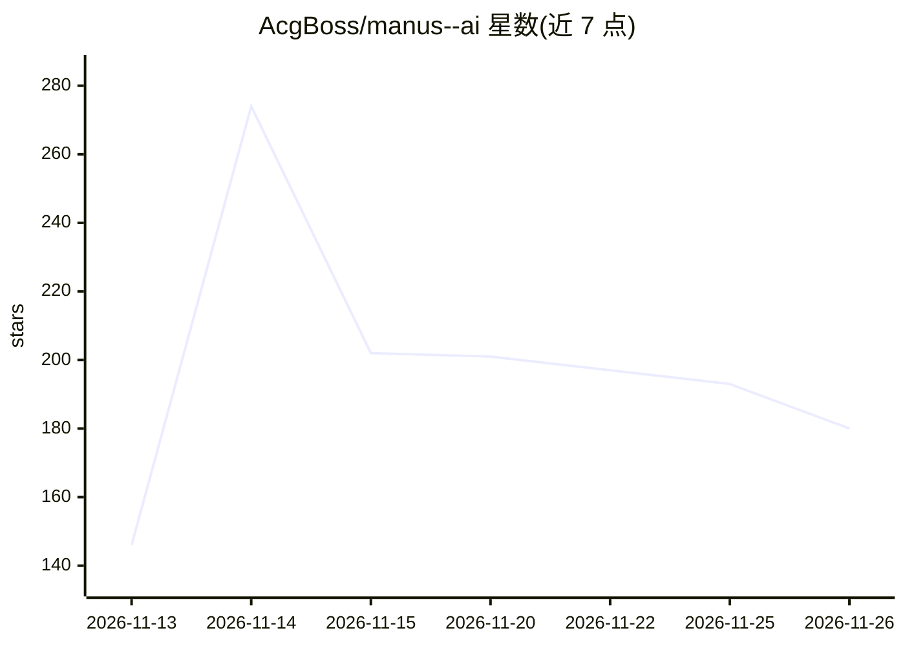

# AcgBoss/manus--ai

⭐ 180 · Apache-2.0 · 推送 2026-11-17 · [GitHub](https://github.com/AcgBoss/manus--ai) · 个人维护

**面向个人用户的自主 AI Agent：代跑代码与操控浏览器**

README 以营销文案介绍 Manus：一个自主执行任务的 AI 代理，可在用户侧编写并运行脚本、打开网页、与页面元素交互、执行多步骤任务，定位为家庭、学习与轻量办公的个人助手，非企业平台。README 声明了软硬件兼容表（双核 CPU、4GB 内存起步）与上手步骤（配置、测试、调整触发条件），但未提供任何安装命令、代码入口或技术实现细节，也无法从 README 验证其开源实现与沙箱机制的具体构成。

## 筛选速览

| 维度 | 判定 | 备注 |
|---|---|---|
| AI 角色 | `ai-native` | 本体是模型或模型工具 |
| 许可风险 | `permissive` | Apache-2.0 |
| 部署形态 | `None` |  |
| 模型依赖 | — | README 未给出锁定关系 |
| 硬件要求 | — | 无带数字的原话,不猜 |
| 安装摩擦 | `low` | 无编译、无系统依赖或容器化 |
| 成熟度 | — | 结构信号不足 |

## 能力要点

- 自主编写并执行代码完成多步骤任务
- 浏览器控制：导航网页、填写表单、采集信息
- 代码与浏览器动作可在同一任务流中衔接
- 面向个人/学习/轻量办公场景的后台个人助手

## 适用场景

- 让代理代为执行重复性的脚本与网页操作
- 研究中收集参考资料并整理笔记
- 批量打开多标签页收集信息并生成小结
- 开发中快速跑小实验而无需搭建完整环境

## 场景标签

`AI 助手` `浏览器自动化` `编码 Agent` · 领域:效率与自动化

## 证据(README 行号)

> L10: - **Autonomous Code Execution:** Manus AI agent runs code on its own to complete tasks, so you can focus on decisio
> L18: Manus is an autonomous AI agent designed to run code and control a browser on your behalf. Instead of acting like a

## 星数曲线

2026-11-13 146 → 2026-11-26 180（+34）

---
*卡片 v1 · prompt 1.4 · 生成 2026-11-18 · 置信度 low · 依据 README sha `32e48e22fb91` · [字段定义](../../DATASET.md)*
