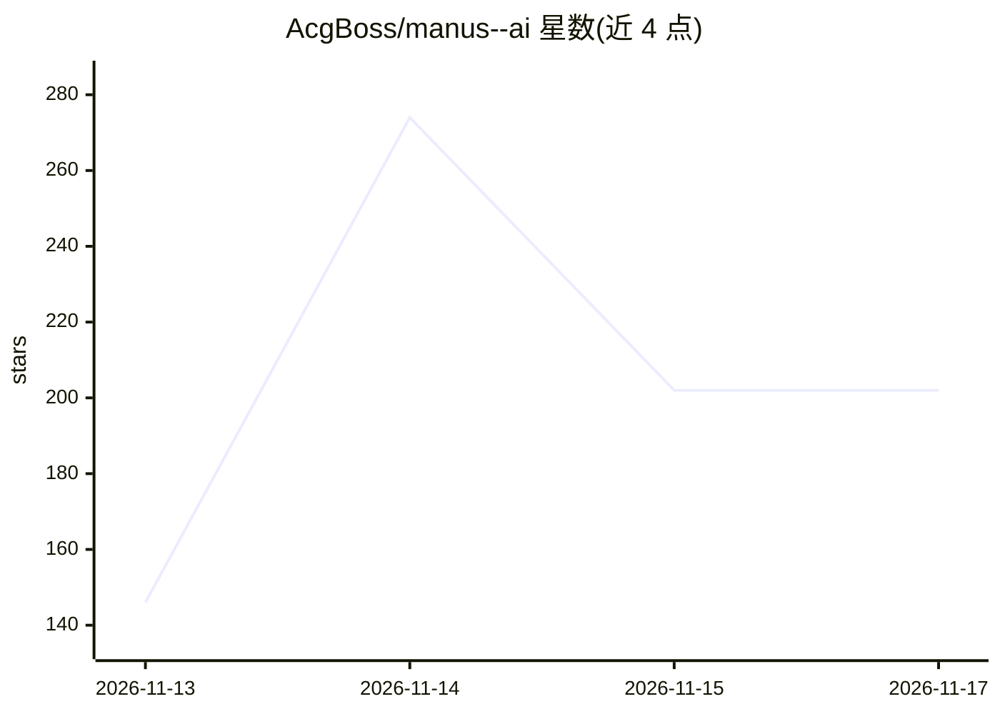

# AcgBoss/manus--ai

⭐ 202 · Apache-2.0 · 推送 2026-11-15 · [GitHub](https://github.com/AcgBoss/manus--ai) · 个人维护

**面向日常任务的自主 AI Agent：代用户执行代码并控制浏览器**

自称 Manus 的自主 AI Agent 系统，描述称其可在沙箱环境中运行工具与操作：代用户编写并执行脚本、控制浏览器（导航网页、填表、采集信息）、执行多步骤任务并跨会话保持一致行为。定位为面向家庭、学习与轻量办公场景的个人助手，而非企业平台。README 给出硬件兼容表（最低 4GB 内存、双核 CPU）与使用步骤说明，但未提供任何可验证的安装命令、代码入口或技术架构细节，内容以功能宣传与搜索关键词堆砌为主。

## 筛选速览

| 维度 | 判定 | 备注 |
|---|---|---|
| AI 角色 | `ai-native` | 本体是模型或模型工具 |
| 许可风险 | `permissive` | Apache-2.0 |
| 部署形态 | `None` |  |
| 模型依赖 | — | README 未给出锁定关系 |
| 硬件要求 | — | 无带数字的原话,不猜 |
| 安装摩擦 | `low` | 无编译、无系统依赖或容器化 |
| 成熟度 | — | 结构信号不足 |

## 能力要点

- 自主执行代码与脚本
- 浏览器控制：导航、填表、信息采集
- 代码与浏览器动作可在同一任务流中衔接
- 面向家庭、学习与轻量办公的多步骤任务

## 适用场景

- 让代理代为执行重复性脚本与浏览器操作
- 学习中整理研究笔记、运行小脚本
- 从多个网页收集信息并准备摘要

## 场景标签

`AI 助手` `浏览器自动化` · 领域:效率与自动化

## 证据(README 行号)

> L10: - **Autonomous Code Execution:** Manus AI agent runs code on its own to complete tasks, so you can focus on decisio
> L18: Manus is an autonomous AI agent designed to run code and control a browser on your behalf. Instead of acting like a

## 星数曲线

2026-11-13 146 → 2026-11-17 202（+56）

---
*卡片 v1 · prompt 1.4 · 生成 2026-11-17 · 置信度 low · 依据 README sha `fbfd5e977bf4` · [字段定义](../../DATASET.md)*
