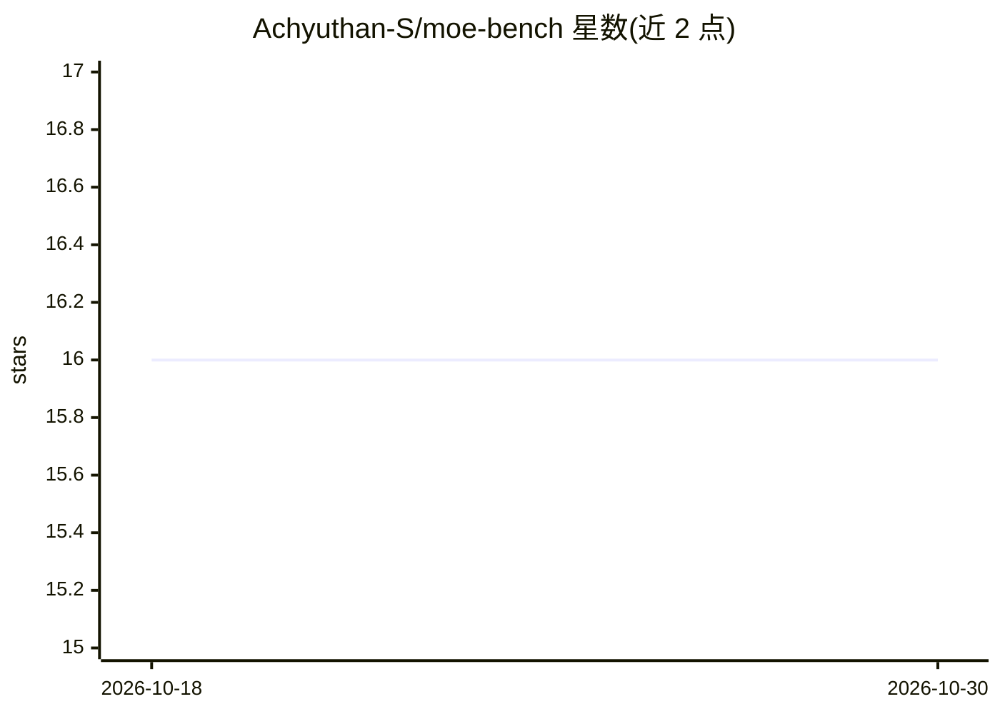

# Achyuthan-S/moe-bench

⭐ 16 · Python · NOASSERTION · 推送 2026-10-21 · [GitHub](https://github.com/Achyuthan-S/moe-bench) · 个人维护

**评测稀疏 MoE LLM 专家坍缩与路由效率的开源基准工具包**

面向研究者的 pip 可安装基准工具包：通过 hooks 采集稀疏 MoE 模型（OLMoE、JetMoE、Qwen1.5-MoE）的路由数据，测量每层路由熵、专家利用率分布与坍缩检测（可配置 τ），并提供 bootstrap 置信区间。附带 L_div 熵下限正则化 LoRA 训练（本版本仅 OLMoE）。开箱可在 24GB Mac（MPS）上运行，CLI 支持 4bit 云 GPU 跑 Mixtral 但本版本未验证。注意：不做下游准确率排行榜。

## 筛选速览

| 维度 | 判定 | 备注 |
|---|---|---|
| AI 角色 | `ai-ecosystem` | LLM/agent 周边工具 |
| 许可风险 | `none` | NOASSERTION |
| 部署形态 | `library` | 以包/库形式分发 |
| 模型依赖 | — | README 未给出锁定关系 |
| 硬件要求 | — | 无带数字的原话,不猜 |
| 安装摩擦 | `low` | 无编译、无系统依赖或容器化 |
| 成熟度 | `idea` | |

## 能力要点

- 每层/每域路由熵（Shannon H）与专家利用率坍缩检测（可配置 τ）
- L_div 熵下限正则化 LoRA 训练，MMLU 子集显示准确率无显著下降
- 开箱支持 OLMoE、JetMoE、Qwen1.5-MoE 三种架构
- 24GB Mac MPS 本地即可运行，提供 CLI 与结果表格

## 适用场景

- 分析我的 MoE 模型是否发生路由坍缩
- 对比不同 MoE 架构的路由熵与专家利用率
- 用 L_div 正则化在微调中抑制坍缩

## 场景标签

`模型评测` `微调` · 领域:评测与运维

## 证据(README 行号)

> L10: > MoE-Bench is a **pip-installable toolkit** for measuring routing entropy, expert utilisation, and collapse in spa
> L14: Sparse MoE models route tokens to a subset of experts per layer. When routing collapses — a small number of experts

## 星数曲线

2026-10-18 16 → 2026-10-30 16（+0）

---
*卡片 v1 · prompt 1.4 · 生成 2026-10-30 · 置信度 high · 依据 README sha `31805486dc42` · [字段定义](../../DATASET.md)*
