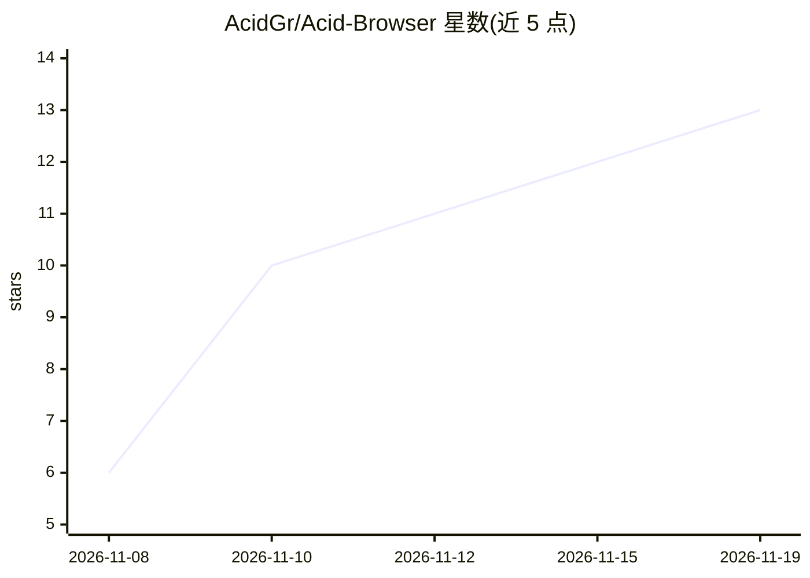

# AcidGr/Acid-Browser

⭐ 13 · Java · MIT · 推送 2026-11-17 · [GitHub](https://github.com/AcidGr/Acid-Browser) · 个人维护 · 中文 README

**超轻量 Android AI 浏览器：内置 Agent 循环、MCP 网关与广告拦截**

基于系统原生 WebView 构建的 Android 浏览器，不依赖 AndroidX 或第三方重量级 SDK，安装包约 520 KB。浏览器本体提供多标签、历史、下载管理、无痕模式、ABP 广告拦截与油猴用户脚本引擎。AI 部分包括原生 Agent 悬浮对话窗（5 个本地沙盒工具：网页操控、文件读写编辑、shell 执行）、可接入 DeepSeek/Kimi 等厂商或任意 OpenAI 兼容接口的模型配置，以及遵循 MCP 协议的本地控制网关，允许电脑端工具远程操控手机浏览器。提供预构建 APK 与源码构建脚本。

## 筛选速览

| 维度 | 判定 | 备注 |
|---|---|---|
| AI 角色 | `ai-enhanced` | 去掉 AI 部分产品仍成立 |
| 许可风险 | `permissive` | MIT |
| 部署形态 | `None` |  |
| 模型依赖 | local-ok | 支持本地模型 |
| 硬件要求 | — | 无带数字的原话,不猜 |
| 安装摩擦 | `medium` | 含编译或系统依赖之一 |
| 成熟度 | — | 结构信号不足 |

## 能力要点

- 原生 Agent 循环：5 个本地沙盒工具，网页操作后自动回传页面快照与语义句柄
- 模型自接入：内置 6 家厂商目录，支持任意 OpenAI Chat Completions 兼容接口
- MCP 本地网关：JSON-RPC 2.0，默认仅监听 127.0.0.1 并强制 Bearer Token 鉴权
- ABP 广告拦截（内置规则+在线订阅）与用户脚本引擎

## 适用场景

- 在 Android 手机上使用内置 Agent 完成网页自动化操作
- 接入自有模型 API 在浏览器内进行 AI 对话
- 用 ABP 规则拦截广告与恶意唤端跳转
- 通过 MCP 让电脑端工具远程操控手机浏览器

## 场景标签

`浏览器自动化` `AI 助手` · 领域:效率与自动化

## 证据(README 行号)

> L3: **Acid Browser** 是一款专为 Android 打造的超轻量、零第三方依赖的智能浏览器。
> L7: 它基于系统原生 `WebView` 构建，不依赖 AndroidX 或任何外部重量级 SDK，安装包体积仅约 **520 KB**。在提供干净、流畅的日常网页浏览体验的同时，原生内嵌了自主 AI Agent 循环、本地沙盒工作区、油
> L55: Acid Browser 不预置任何密钥，模型完全由你自己接入。**支持 DeepSeek、Kimi、阿里云百炼（Qwen）、小米 MiMo、MiniMax、硅基流动等主流厂商，也支持任意 OpenAI 兼容接口**（中转网关、O

## 星数曲线

2026-11-08 6 → 2026-11-19 13（+7）

---
*卡片 v1 · prompt 1.4 · 生成 2026-11-18 · 置信度 high · 依据 README sha `d9e87eb46055` · [字段定义](../../DATASET.md)*
