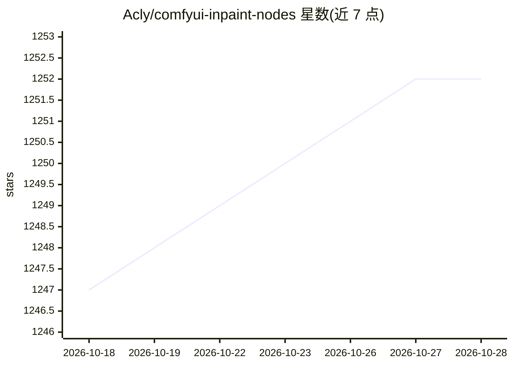

# Acly/comfyui-inpaint-nodes

⭐ 1,251 · Python · GPL-3.0 · 推送 2026-10-04 · [GitHub](https://github.com/Acly/comfyui-inpaint-nodes) · 个人维护

**ComfyUI 图像重绘节点集：Fooocus 重绘模型、LaMa/MAT 与遮罩预处理**

面向 ComfyUI 用户的自定义节点集合，用于图像重绘（inpainting）与外绘（outpainting）。提供 Fooocus inpaint 补丁将 SDXL 检查点转换为重绘模型，支持加载 LaMa、MAT 等小型重绘模型；另含遮罩扩展/收缩/稳定化、遮罩区域填充（neutral/telea/navier-stokes）、模糊、色彩匹配等前后处理节点。通过 ComfyUI Manager、手动复制或 git clone 安装，telea 与 navier-stokes 填充模式需另装 OpenCV。

## 筛选速览

| 维度 | 判定 | 备注 |
|---|---|---|
| AI 角色 | `ai-ecosystem` | LLM/agent 周边工具 |
| 许可风险 | `viral` | GPL-3.0 |
| 部署形态 | `library` | 以包/库形式分发 |
| 模型依赖 | — | README 未给出锁定关系 |
| 硬件要求 | — | 无带数字的原话,不猜 |
| 安装摩擦 | `low` | 无编译、无系统依赖或容器化 |
| 成熟度 | — | 结构信号不足 |

## 能力要点

- Fooocus inpaint 补丁可将 SDXL 检查点转换为重绘模型
- 支持加载 LaMa、MAT 小型重绘模型用于外绘与物体移除
- 遮罩扩展/收缩/稳定化与三种填充模式（neutral/telea/navier-stokes）
- 遮罩区域色彩匹配与去噪转合成遮罩等后处理节点

## 适用场景

- 在 ComfyUI 中对 SDXL 模型做高质量图像重绘
- 外绘或移除图中物体时预填充遮罩区域
- 修正重绘输出中的色彩/亮度偏移

## 场景标签

`图像生成` · 领域:内容生成

## 证据(README 行号)

> L3: Nodes for better inpainting with ComfyUI: Fooocus inpaint model for SDXL, LaMa, MAT,
> L8: Adds two nodes which allow using Fooocus inpaint model.

## 星数曲线

2026-10-18 1,247 → 2026-10-28 1,252（+5）

---
*卡片 v1 · prompt 1.4 · 生成 2026-10-21 · 置信度 mid · 依据 README sha `e01222dfafe4` · [字段定义](../../DATASET.md)*
