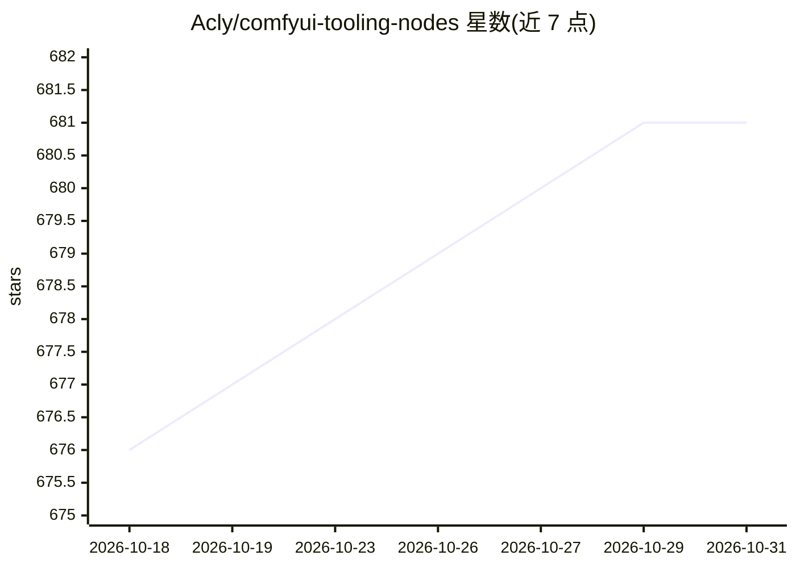

# Acly/comfyui-tooling-nodes

⭐ 681 · Python · GPL-3.0 · 推送 2026-10-04 · [GitHub](https://github.com/Acly/comfyui-tooling-nodes) · 个人维护

**将 ComfyUI 作为外部工具后端的节点与 HTTP API 扩展**

ComfyUI 自定义节点集合，面向把 ComfyUI 用作后端的外部工具开发者：提供图像收发节点（Base64 嵌入提示词、WebSocket 二进制传输、RAM 缓存上传下载），绕过文件系统交换；区域注意力遮罩节点让提示词只作用于遮罩区域；图像分块节点用于加速扩散并节省显存；另有本地文本翻译（Argos Translate）、NSFW 过滤，以及模型分类查询、翻译、模型上传等 HTTP API 扩展。安装方式为克隆仓库至 custom_nodes 目录。

## 筛选速览

| 维度 | 判定 | 备注 |
|---|---|---|
| AI 角色 | `ai-ecosystem` | LLM/agent 周边工具 |
| 许可风险 | `viral` | GPL-3.0 |
| 部署形态 | `library` | 以包/库形式分发 |
| 模型依赖 | — | README 未给出锁定关系 |
| 硬件要求 | — | 无带数字的原话,不猜 |
| 安装摩擦 | `low` | 无编译、无系统依赖或容器化 |
| 成熟度 | — | 结构信号不足 |

## 能力要点

- Base64/WebSocket/RAM 缓存三种图像收发机制，无需文件系统上传下载
- 区域注意力遮罩：多个提示词分别作用于图像不同区域
- 图像分块与合并节点，加速扩散并节省显存
- HTTP API：模型分类识别（含 GGUF/SVDQuant 量化检测）、翻译、模型上传

## 适用场景

- 为外部工具（如 Photoshop 插件、Web 应用）提供 ComfyUI 后端接口
- 大图生成时用分块处理降低显存占用
- 多区域分别提示词控制的图像生成
- 工具内集成多语言提示词翻译与 NSFW 过滤

## 场景标签

`图像生成` · 领域:内容生成

## 证据(README 行号)

> L3: Provides nodes and API geared towards using ComfyUI as a backend for external tools.
> L187: ### GET /api/etn/model_info/{folder_name}

## 星数曲线

2026-10-18 676 → 2026-10-31 681（+5）

---
*卡片 v1 · prompt 1.4 · 生成 2026-10-21 · 置信度 mid · 依据 README sha `64573edc3eab` · [字段定义](../../DATASET.md)*
