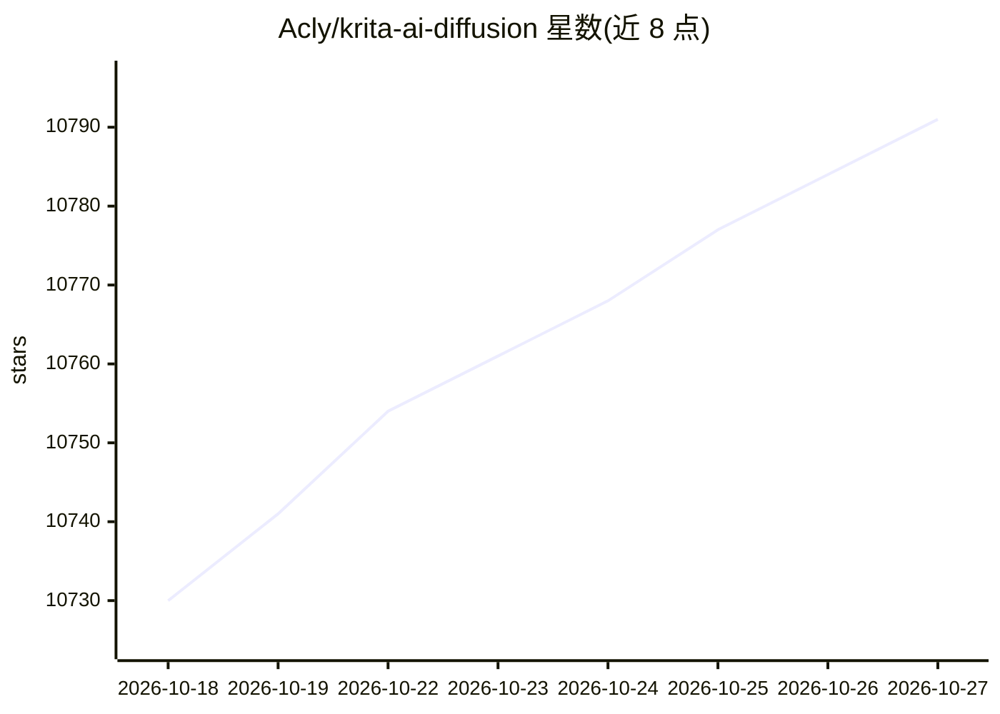

# Acly/krita-ai-diffusion

⭐ 10,791 · Python · GPL-3.0 · 推送 2026-10-03 · [GitHub](https://github.com/Acly/krita-ai-diffusion) · [官网](https://www.interstice.cloud) · 个人维护

**Krita 绘画软件的 AI 图像生成插件**

在 Krita 图像绘画与编辑工作流内使用生成式 AI 的插件：支持基于选区的生成式填充/扩展（Inpainting）、实时 Live Painting、图像放大至 4k/8k+，兼容 Flux 2、Z-Image、Stable Diffusion 1.5/XL/Illustrious 等模型，并提供 ControlNet（线稿/姿态/深度等）、IP-Adapter、分层区域文本描述等控制方式。后端使用 ComfyUI，可本地运行（需较强 GPU，建议 NVIDIA 6GB+ VRAM，也支持 AMD ROCm、Intel XPU、Apple Silicon MPS 与 CPU），也可连接远程服务器或使用云端生成。以 ZIP 插件包形式经 Krita 脚本导入安装，要求 Krita 5.2.0+。

## 筛选速览

| 维度 | 判定 | 备注 |
|---|---|---|
| AI 角色 | `ai-native` | 本体是模型或模型工具 |
| 许可风险 | `viral` | GPL-3.0 |
| 部署形态 | `None` |  |
| 模型依赖 | — | README 未给出锁定关系 |
| 硬件要求 | `gpu-8g` | |
| 安装摩擦 | `medium` | 含编译或系统依赖之一 |
| 成熟度 | — | 结构信号不足 |

## 能力要点

- 基于选区的 Inpainting/Outpaint 与分层区域文本控制
- 支持 Flux 2、Stable Diffusion 1.5/XL/Illustrious 等扩散模型
- ControlNet 与 IP-Adapter 提供线稿、姿态、深度、参考图等控制
- 后端为 ComfyUI，可全自动本地安装或连接自定义/远程服务器

## 适用场景

- 在 Krita 中对选区做生成式填充、扩展或物体增删
- 绘画过程中实时由 AI 解析画布获得即时反馈
- 用线稿、姿态、深度图等控制生成结果并迭代细化

## 场景标签

`图像生成` · 领域:内容生成

## 证据(README 行号)

> L5: This is a plugin to use generative AI in image painting and editing workflows
> L26: * **Inpainting**: Use selections for generative fill, expand, to add or remove objects
> L118: * Image generation: Stable Diffusion, Flux

## 星数曲线

2026-10-18 10,730 → 2026-10-27 10,791（+61）

---
*卡片 v1 · prompt 1.4 · 生成 2026-10-20 · 置信度 high · 依据 README sha `6e160e489eb7` · [字段定义](../../DATASET.md)*
