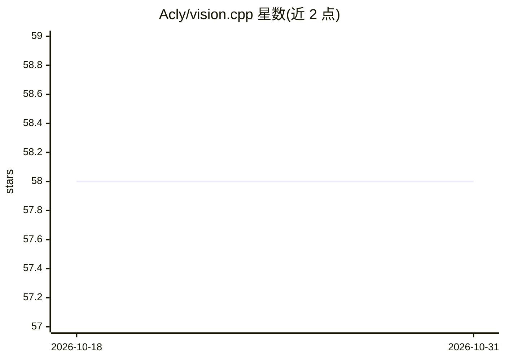

# Acly/vision.cpp

⭐ 58 · C++ · MIT · 推送 2026-04-02 · [GitHub](https://github.com/Acly/vision.cpp) · 个人维护

**C++ 计算机视觉推理库：消费级 CPU/GPU 上运行分割、深度估计等模型**

基于 ggml 的自包含 C++ 计算机视觉推理库，与 llama.cpp 同源技术栈。支持 MobileSAM（可提示分割）、BiRefNet（二分分割）、Depth-Anything（深度估计）、MI-GAN（图像修复）、ESRGAN（超分辨率）等模型，后端覆盖 CPU 与 Vulkan GPU（NVIDIA/AMD/Intel）。提供高层 C++ API 与 vision-cli 命令行工具，可从 PyTorch 权重转换为 GGUF 格式。模型与后端仍在持续增加，模块化设计便于自行实现新模型。

## 筛选速览

| 维度 | 判定 | 备注 |
|---|---|---|
| AI 角色 | `ai-native` | 本体是模型或模型工具 |
| 许可风险 | `permissive` | MIT |
| 部署形态 | `None` |  |
| 模型依赖 | — | README 未给出锁定关系 |
| 硬件要求 | — | 无带数字的原话,不猜 |
| 安装摩擦 | `high` | 编译与系统依赖俱全 |
| 成熟度 | `idea` | |

## 能力要点

- 自包含 C++ 库，支持 CPU 与 Vulkan GPU 后端
- 覆盖分割/深度估计/修复/超分辨率 5 类模型
- vision-cli 命令行与高层 C++ API 两种使用方式
- 提供 PyTorch 权重到 GGUF 的转换脚本

## 适用场景

- 在 C++ 应用中集成图像分割或深度估计能力
- 消费级硬件上部署轻量计算机视觉推理（部署体积 <5MB CPU）
- 通过 CLI 快速对图像生成分割掩码或深度图

## 场景标签

`推理引擎` `图像视频处理` `目标检测` · 领域:感知与多模态

## 证据(README 行号)

> L3: Computer Vision ML inference in C++
> L17: |**MobileSAM**|Promptable segmentation|CPU, Vulkan|
> L46: vision-cli -m MobileSAM-F16.gguf -i input.jpg -p 420 120 650 430 -o mask.png

## 星数曲线

2026-10-18 58 → 2026-10-31 58（+0）

---
*卡片 v1 · prompt 1.4 · 生成 2026-10-24 · 置信度 high · 依据 README sha `f0525f0a308e` · [字段定义](../../DATASET.md)*
