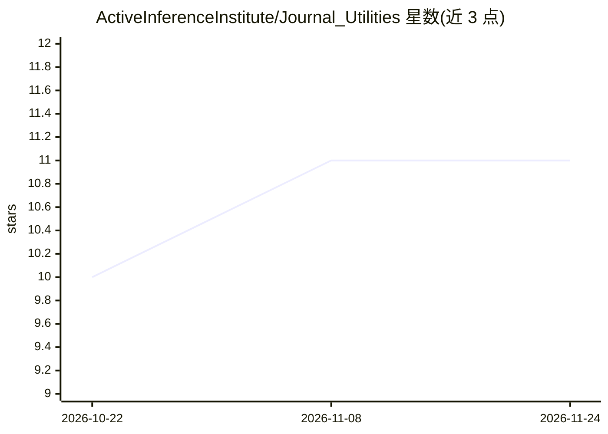

# ActiveInferenceInstitute/Journal_Utilities

⭐ 11 · HTML · CC0-1.0 · 推送 2026-11-21 · [GitHub](https://github.com/ActiveInferenceInstitute/Journal_Utilities) · 组织维护

**为 Active Inference 期刊内容创作提供的工具与文档集**

面向为 Active Inference Journal 创建内容的贡献者，提供工具与文档（主题标签涉及 Python、RAG、转录、视频处理、Whisper、YouTube）。当前展示的 README 部分聚焦仓库的 GitHub 自动化配置：CI 工作流、依赖更新与 GNN 一致性检查，说明 `test.yml` 调用 `uv run python run.py gate` 作为贡献者使用的同一入口，并提供 RUN_GUIDE.md 与 CONTRIBUTING.md 等文档指引。

## 筛选速览

| 维度 | 判定 | 备注 |
|---|---|---|
| AI 角色 | `ai-knowledge` | 知识聚合/清单类 |
| 许可风险 | `viral` | CC0-1.0 |
| 部署形态 | `None` |  |
| 模型依赖 | — | README 未给出锁定关系 |
| 硬件要求 | — | 无带数字的原话,不猜 |
| 安装摩擦 | `low` | 无编译、无系统依赖或容器化 |
| 成熟度 | — | 结构信号不足 |

## 能力要点

- 提供 CI、依赖更新与 GNN 一致性检查的 GitHub 自动化配置
- 统一入口 `uv run python run.py gate`，与贡献者本地检查一致
- 工作流 setup actions 以 commit 精确固定并启用缓存
- 文档体系：RUN_GUIDE.md 与 CONTRIBUTING.md 指引门禁命令

## 适用场景

- 为 Active Inference Journal 制作期刊内容（据描述与主题标签）
- 作为贡献者运行仓库统一的 gate 检查流程
- 维护该仓库 CI 工作流与 Dependabot 依赖更新

## 场景标签

`RAG` `语音识别` `图像视频处理` · 领域:知识与检索

## 证据(README 行号)

> L3: GitHub configuration for `ActiveInferenceInstitute/Journal_Utilities`. Nothing here
> L10: The workflows do not restate any gate command: both `test.yml` jobs call
> L11: `uv run python run.py gate …`, the same entry point a contributor uses

## 星数曲线

2026-10-22 10 → 2026-11-24 11（+1）

---
*卡片 v1 · prompt 1.4 · 生成 2026-11-19 · 置信度 low · 依据 README sha `20accad5cca7` · [字段定义](../../DATASET.md)*
