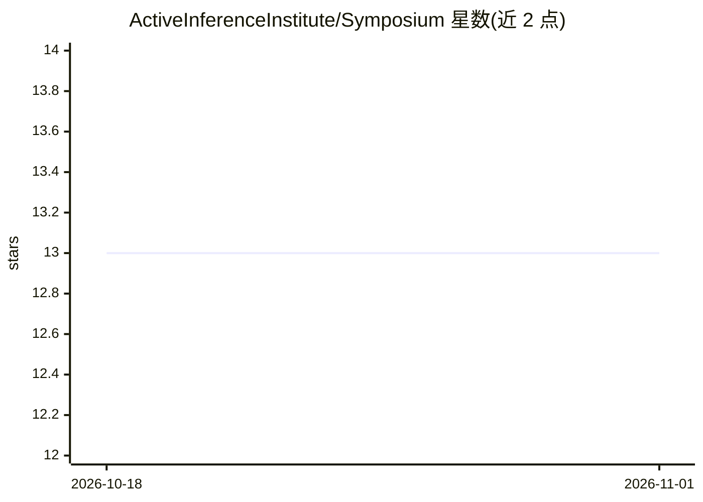

# ActiveInferenceInstitute/Symposium

⭐ 13 · Python · MIT · 推送 2026-10-27 · [GitHub](https://github.com/ActiveInferenceInstitute/Symposium) · [官网](https://activeinferenceinstitute.github.io/Symposium/) · 组织维护

**Active Inference 研讨会组织与研究分析 Python 工具集**

面向 Active Inference Institute 研讨会组织者的 Python 工具：管理演讲者研究档案、参与者学习计划、项目提案、文本可视化与日历导出（ICS/JSON/CSV），并以可搜索工作流将研讨会方法关联到 Institute 公开仓库。核心组织与校验流程离线运行、无需 API key；可选付费分析通过 Perplexity 做网络辅助背景研究、OpenRouter 做档案分析与课程生成，AI 产出需组织者审核后才可分享。要求 Python 3.12+ 与 uv，版本初始化支持 macOS/Linux。

## 筛选速览

| 维度 | 判定 | 备注 |
|---|---|---|
| AI 角色 | `ai-enhanced` | 去掉 AI 部分产品仍成立 |
| 许可风险 | `permissive` | MIT |
| 部署形态 | `None` |  |
| 模型依赖 | — | README 未给出锁定关系 |
| 硬件要求 | — | 无带数字的原话,不猜 |
| 安装摩擦 | `low` | 无编译、无系统依赖或容器化 |
| 成熟度 | — | 结构信号不足 |

## 能力要点

- 演讲者/参与者分析、课程与基于 catechism 的项目提案生成
- 文本嵌入、网络、分布、词云与 PCA 的 PNG 可视化
- 同意（consent）门控的公开发布流程与 intake 审查报告
- 离线组织与校验命令，无需 API 凭证

## 适用场景

- 组织学术研讨会并管理参与者数据与公开发布
- 为演讲者生成研究档案与参与者定制学习计划
- 将研讨会方法与机构公开仓库建立可搜索关联

## 场景标签

`工作流自动化` `科研工具` · 领域:效率与自动化

## 证据(README 行号)

> L6: Python tools for presenter research profiles, participant learning plans, project
> L29: These commands run offline without API keys. The website publishes a page sitemap,
> L46: Initialization and validation run offline without API credentials. Edition initialization

## 星数曲线

2026-10-18 13 → 2026-11-01 13（+0）

---
*卡片 v1 · prompt 1.4 · 生成 2026-10-31 · 置信度 mid · 依据 README sha `d36a0909fbc9` · [字段定义](../../DATASET.md)*
