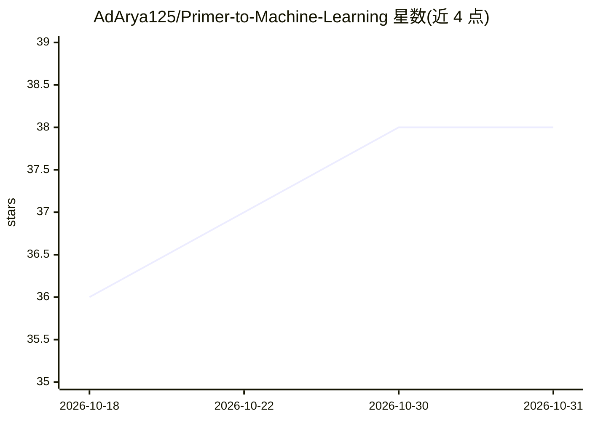

# AdArya125/Primer-to-Machine-Learning

⭐ 38 · Jupyter Notebook · MIT · 推送 2026-08-21 · [GitHub](https://github.com/AdArya125/Primer-to-Machine-Learning) · 个人维护

**机器学习入门到进阶的结构化学习路线指南**

由个人维护的机器学习学习指南仓库，以目录树形式覆盖统计、数据预处理与特征工程、优化方法、监督/无监督学习、模型评估、神经网络与深度学习、NLP、时间序列分析与强化学习共 10 个主题。每个条目链接到配套 notebook（PCA、XGBoost、CNN、Transformer/BERT、ARIMA、DQN 等），并在每章末尾列出 Khan Academy、Coursera、Kaggle 等推荐外部学习资源。面向初学者到有经验的学习者，仓库本身不提供可安装的软件，仅作为知识索引与代码示例集。

## 筛选速览

| 维度 | 判定 | 备注 |
|---|---|---|
| AI 角色 | `ai-knowledge` | 知识聚合/清单类 |
| 许可风险 | `permissive` | MIT |
| 部署形态 | `None` |  |
| 模型依赖 | — | README 未给出锁定关系 |
| 硬件要求 | — | 无带数字的原话,不猜 |
| 安装摩擦 | `low` | 无编译、无系统依赖或容器化 |
| 成熟度 | — | 结构信号不足 |

## 能力要点

- 10 大主题的机器学习知识目录结构
- 每个条目链接配套 .ipynb 实践笔记本
- 每章附 Khan Academy/Coursera/Kaggle 推荐资源

## 适用场景

- 按结构化路线系统自学机器学习各主题
- 查找特定算法（如 DBSCAN、BERT、Q-Learning）的实践 notebook
- 获取各主题的推荐课程与入门资料

## 场景标签

`教程课程` · 领域:学习与行业

## 证据(README 行号)

> L5: Welcome to the **Primer to Machine Learning** repository, a structured guide designed to help you explore and master
> L7: # 1. Statistics for Machine Learning

## 星数曲线

2026-10-18 36 → 2026-10-31 38（+2）

---
*卡片 v1 · prompt 1.4 · 生成 2026-10-25 · 置信度 high · 依据 README sha `7c9f042570f5` · [字段定义](../../DATASET.md)*
