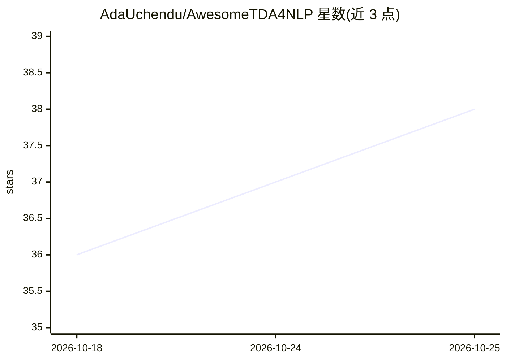

# AdaUchendu/AwesomeTDA4NLP

⭐ 38 · Jupyter Notebook · MIT · 推送 2026-06-25 · [GitHub](https://github.com/AdaUchendu/AwesomeTDA4NLP) · 个人维护

**TDA 在 NLP 应用的论文综述清单（137 篇）**

由 Uchendu 与 Le 维护的 Awesome 型论文清单，配套综述论文，收录 137 篇拓扑数据分析（TDA）应用于自然语言处理的论文，按理论方法（语义/句法拓扑空间、主题演化拓扑、词汇形状）与非理论方法（TF-IDF、预训练嵌入如 Word2Vec 等）分类组织，每条含论文出处与链接。条目为静态列表，不含代码或安装方式。

## 筛选速览

| 维度 | 判定 | 备注 |
|---|---|---|
| AI 角色 | `ai-knowledge` | 知识聚合/清单类 |
| 许可风险 | `permissive` | MIT |
| 部署形态 | `None` |  |
| 模型依赖 | — | README 未给出锁定关系 |
| 硬件要求 | — | 无带数字的原话,不猜 |
| 安装摩擦 | `low` | 无编译、无系统依赖或容器化 |
| 成熟度 | — | 结构信号不足 |

## 能力要点

- 收录 137 篇 TDA×NLP 论文并按理论/非理论两大类细分
- 理论类覆盖语义拓扑空间、句法拓扑空间、主题演化、词汇拓扑形状
- 非理论类按 TF-IDF、Word2Vec 等表示技术分组
- 提供 bibtex 引用条目与论文链接

## 适用场景

- 查找 TDA 应用于 NLP 的研究文献
- 了解拓扑方法在语言处理领域的分类与研究脉络
- 撰写相关综述或选课时作为起点文献目录

## 场景标签

`精选清单` `科研工具` · 领域:学习与行业

## 证据(README 行号)

> L11: of TDA in NLP, yielding **137 papers** we comprehensively survey in this paper. Our findings categorize these effor
> L30: ## Paper List

## 星数曲线

2026-10-18 36 → 2026-10-25 38（+2）

---
*卡片 v1 · prompt 1.4 · 生成 2026-10-25 · 置信度 high · 依据 README sha `53ea01bdcdd3` · [字段定义](../../DATASET.md)*
