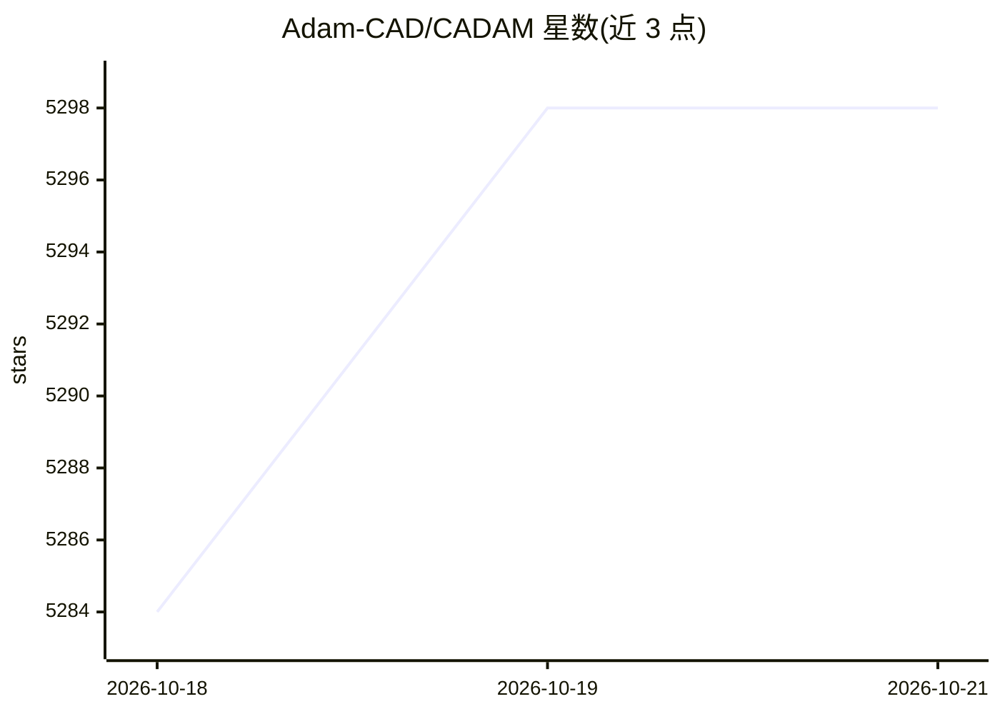

# Adam-CAD/CADAM

⭐ 5,298 · TypeScript · GPL-3.0 · 推送 2026-10-15 · [GitHub](https://github.com/Adam-CAD/CADAM) · [官网](https://adam.new/cadam) · 组织维护

**开源文本生成 CAD 模型的 Web 应用：自然语言/图片转 3D 模型**

基于浏览器的 text-to-CAD 应用：输入自然语言描述或上传图片，生成全参数化 OpenSCAD 代码并可导出 .STL/.SCAD/.DXF；自动提取可调尺寸并以滑杆交互，参数修改无需重新调用 AI 生成。CAD 引擎为 OpenSCAD WebAssembly，在浏览器本地运行，内置 BOSL/BOSL2/MCAD 库；AI 部分使用 Anthropic Claude API，后端为 React 19 + TanStack Start + Supabase。提供在线 demo，自部署需 Node.js 20+/Supabase CLI/ngrok 及多家 API key。GPLv3 许可。

## 筛选速览

| 维度 | 判定 | 备注 |
|---|---|---|
| AI 角色 | `ai-native` | 本体是模型或模型工具 |
| 许可风险 | `viral` | GPL-3.0 |
| 部署形态 | `library` | 以包/库形式分发 |
| 模型依赖 | locked-api |  |
| 硬件要求 | — | 无带数字的原话,不猜 |
| 安装摩擦 | `low` | 无编译、无系统依赖或容器化 |
| 成熟度 | — | 结构信号不足 |

## 能力要点

- 自然语言与图片输入生成参数化 OpenSCAD 3D 模型
- 交互滑杆调尺寸，参数改动无需 AI 重新生成
- OpenSCAD WebAssembly 浏览器端运行，导出 STL/SCAD/DXF
- 内置 BOSL/BOSL2/MCAD OpenSCAD 库

## 适用场景

- 用一句话描述快速生成可 3D 打印的零件模型
- 生成螺纹、齿轮等参数化机械零件并调整尺寸
- 在浏览器中体验 text-to-CAD 而无需本地安装 CAD 软件

## 场景标签

`代码生成` · 领域:编码与开发

## 证据(README 行号)

> L28: - 🤖 **AI-Powered Generation** - Transform natural language and images into 3D models
> L31: - 🌐 **Browser-Based** - Runs entirely in your browser using WebAssembly

## 星数曲线

2026-10-18 5,284 → 2026-10-21 5,298（+14）

---
*卡片 v1 · prompt 1.4 · 生成 2026-10-20 · 置信度 high · 依据 README sha `b06c23e009e1` · [字段定义](../../DATASET.md)*
