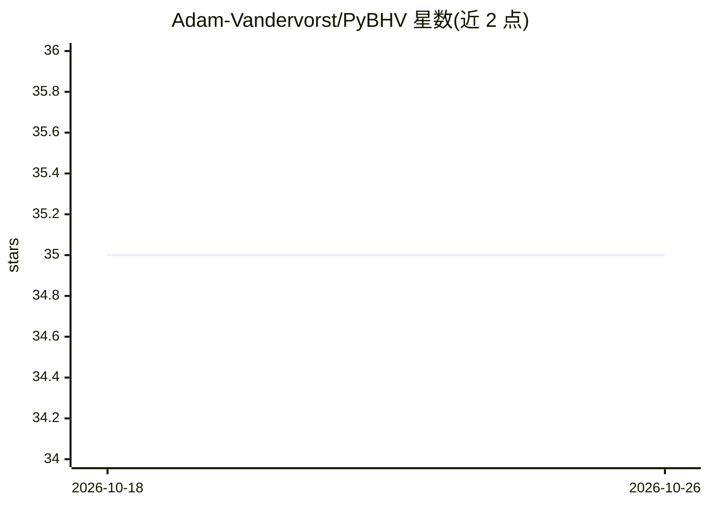

# Adam-Vandervorst/PyBHV

⭐ 35 · Python · GPL-3.0 · 推送 2026-03-05 · [GitHub](https://github.com/Adam-Vandervorst/PyBHV) · 个人维护

**布尔超向量研究框架：面向超维度计算实验的多后端 Python 库**

面向超维度计算（HDC）研究者的 Python 框架，在大型布尔向量上提供 XOR、MAJ、PERMUTE 等代数运算及多种算子（随机向量生成、哈希编码、复合操作、多种距离度量）。支持四种计算后端：纯 Python、原生 C++（位打包与 SIMD）、NumPy、PyTorch；默认维度 8192，安装时可通过 DIMENSION 环境变量指定。附符号实现、表达式化简、电路编译、图可视化与笔记本教程。README 声明命名与功能可能变动。

## 筛选速览

| 维度 | 判定 | 备注 |
|---|---|---|
| AI 角色 | `ai-native` | 本体是模型或模型工具 |
| 许可风险 | `viral` | GPL-3.0 |
| 部署形态 | `library` | 以包/库形式分发 |
| 模型依赖 | — | README 未给出锁定关系 |
| 硬件要求 | — | 无带数字的原话,不猜 |
| 安装摩擦 | `low` | 无编译、无系统依赖或容器化 |
| 成熟度 | `idea` | |

## 能力要点

- 四种计算后端：纯 Python、C++（位打包+SIMD）、NumPy、PyTorch
- 位打包表示相比 NumPy/PyTorch bool 节省 8 倍内存
- 基于代数定律的表达式化简与编译为运算序列（电路）
- 含分类、图分类、逻辑综合、元胞自动机等示例与教程笔记本

## 适用场景

- 在布尔超向量上做超维度计算/向量符号架构的代数实验
- 对比不同后端与实现的性能和正确性
- 复现或扩展基于 MAJ 算子的分类与图分类方法

## 场景标签

 · 领域:机器学习/认知计算研究

## 证据(README 行号)

> L1: # Python Boolean Hyper-Vectors
> L3: A rich research framework for hyperdimensional computing on large boolean vectors supporting program transformation 
> L10: The fundamental research includes finding algebras with interesting properties on top of large boolean vectors. To 

## 星数曲线

2026-10-18 35 → 2026-10-26 35（+0）

---
*卡片 v1 · prompt 1.4 · 生成 2026-10-25 · 置信度 high · 依据 README sha `2a6504f30c6b` · [字段定义](../../DATASET.md)*
