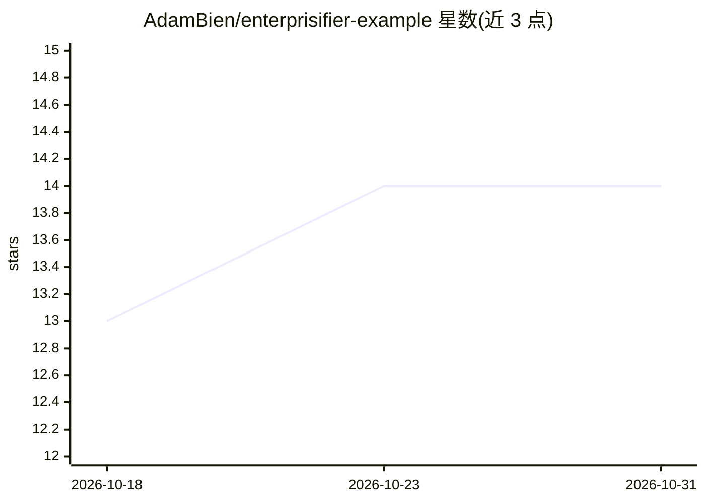

# AdamBien/enterprisifier-example

⭐ 14 · Java · MIT · 推送 2026-04-01 · [GitHub](https://github.com/AdamBien/enterprisifier-example) · 个人维护

**讽刺性 Java 示例：用 73 类企业架构实现 hello, world**

Java 语言的设计模式教学/讽刺示例工程：将两行 hello-world 程序分解为 73 个类、19 个包、7 个架构层，逐条应用策略、抽象工厂、建造者、单例、代理、装饰器、CQRS、事件溯源、Saga、六边形架构等约 20 种模式，并以 README 逐项说明意图、应用方式与收益。运行方式为初始化 GreetingModule 后实例化 GreetingController 并调用 execute()，最终输出 hello, world。属于面向开发者的模式示范代码，非生产用途。

## 筛选速览

| 维度 | 判定 | 备注 |
|---|---|---|
| AI 角色 | `ai-ecosystem` | LLM/agent 周边工具 |
| 许可风险 | `permissive` | MIT |
| 部署形态 | `None` |  |
| 模型依赖 | — | README 未给出锁定关系 |
| 硬件要求 | — | 无带数字的原话,不猜 |
| 安装摩擦 | `low` | 无编译、无系统依赖或容器化 |
| 成熟度 | — | 结构信号不足 |

## 能力要点

- 73 个类、19 个包、7 层架构实现 hello, world 输出
- README 以目录形式逐条解释约 20 种 GoF/架构模式的应用位置与收益
- 包含 Mermaid 层交互图与 16 步 Getting Started 调用流程说明

## 适用场景

- 学习设计模式在极端抽象下的组织方式与代价
- 作为企业级过度工程的反面教材在演讲或教学中引用
- 对照六边形架构、CQRS、事件 sourcing 的分层示例理解各模式角色

## 场景标签

`教程课程` · 领域:学习与行业

## 证据(README 行号)

> L8: The EnterpriseGreetingFramework™ decomposes the two-line hello-world program into **73 classes**
> L3: > A production-grade, cloud-native, hexagonally-architected, event-sourced, CQRS-enabled,

## 星数曲线

2026-10-18 13 → 2026-10-31 14（+1）

---
*卡片 v1 · prompt 1.4 · 生成 2026-10-31 · 置信度 low · 依据 README sha `8ea6354666c0` · [字段定义](../../DATASET.md)*
