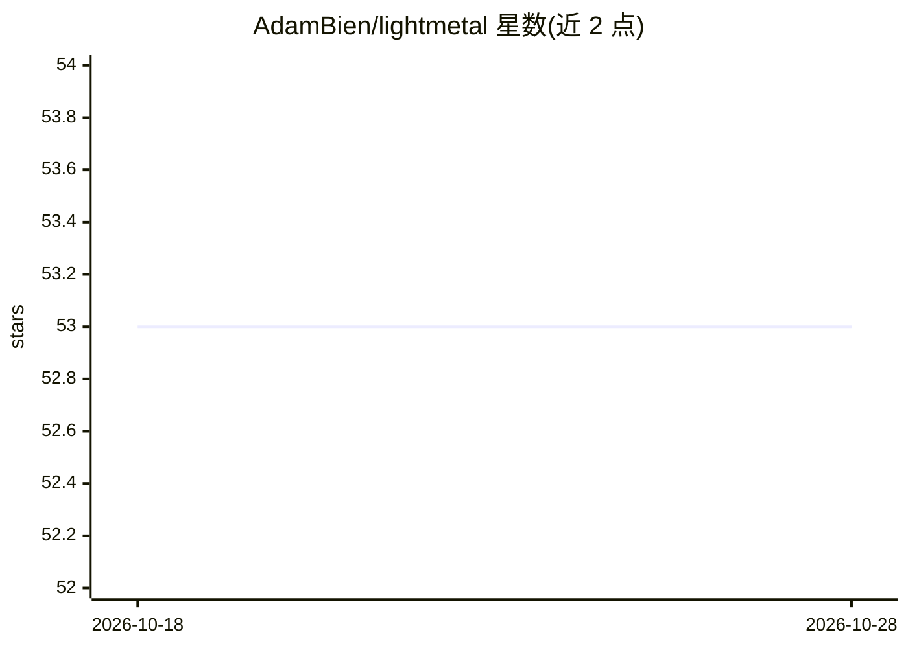

# AdamBien/lightmetal

⭐ 53 · Java · MIT · 推送 2026-10-13 · [GitHub](https://github.com/AdamBien/lightmetal) · 个人维护

**零依赖 Java 25 单 JAR：在 Apple Silicon 上 GPU 运行 GGUF LLM**

单个 Java 25 可执行 JAR，通过 Foreign Function & Memory API 绑定 llama.cpp 的 Metal 版 libllama.dylib，在 Apple Silicon 上运行 Mistral、Gemma、Nemotron、Mellum 架构的 GGUF 模型。提供 CLI 一次性生成、Anthropic 兼容 /v1/messages 与 OpenAI 兼容 /v1/chat/completions（含 SSE 流式与 tool_calls）HTTP 服务，以及 ServiceLoader SPI 嵌入方式。仅需配置 model 属性（GGUF 文件名），附带 lmprompt/lmlist/lmprobe/lmtps 四个脚本。限制：依赖 llama.cpp 且上下文串行处理（非线程安全）。

## 筛选速览

| 维度 | 判定 | 备注 |
|---|---|---|
| AI 角色 | `ai-ecosystem` | LLM/agent 周边工具 |
| 许可风险 | `permissive` | MIT |
| 部署形态 | `desktop` | 安装包/桌面程序 |
| 模型依赖 | local-ok | 支持本地模型 |
| 硬件要求 | — | 无带数字的原话,不猜 |
| 安装摩擦 | `medium` | 含编译或系统依赖之一 |
| 成熟度 | — | 结构信号不足 |

## 能力要点

- 零依赖单 JAR，通过 FFM API 绑定 Metal 版 libllama.dylib
- Anthropic /v1/messages 与 OpenAI /v1/chat/completions 双协议端点（SSE 流式、tool_calls）
- ServiceLoader SPI 嵌入：BinaryOperator/UnaryOperator 接口，无需编译期依赖
- 附带 lminstall 安装脚本与 lmprompt/lmlist/lmprobe/lmtps 四个工具脚本

## 适用场景

- 在 Mac 上用一条 Java 命令本地跑 GGUF 模型做问答生成
- 给 Continue、Aider、Open WebUI 等客户端提供本地 OpenAI 兼容推理端点
- 把 LLM 生成通过 SPI 直接嵌入 Java 应用

## 场景标签

`推理引擎` · 领域:训练与推理

## 证据(README 行号)

> L3: GPU LLM inference on Apple Silicon from a single Java 25 executable JAR with
> L4: zero dependencies. Binds a Metal-enabled `libllama.dylib` through the Foreign
> L70: `-serve` starts an Anthropic-compatible `POST /v1/messages` endpoint instead of
> L98: `POST /v1/chat/completions` and `GET /v1/models` (aliased as

## 星数曲线

2026-10-18 53 → 2026-10-28 53（+0）

---
*卡片 v1 · prompt 1.4 · 生成 2026-10-24 · 置信度 high · 依据 README sha `2b1a2d11439f` · [字段定义](../../DATASET.md)*
