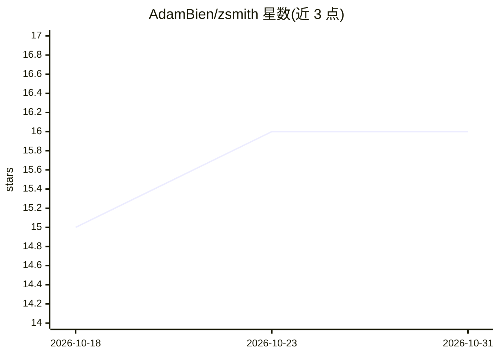

# AdamBien/zsmith

⭐ 16 · Java · MIT · 推送 2026-10-16 · [GitHub](https://github.com/AdamBien/zsmith) · [官网](https://bce.design) · 个人维护

**Java 25 零依赖 AI agent 框架：单 jar 提供 agentic 循环与工具执行**

面向 Java 开发者的 AI agent harness，整个实现打包为单个 296 KB jar，仅依赖 JDK 25，无外部库。提供 agentic 循环（chat/act）、工具执行、预定义工具组、子 agent、SKILL.md 支持、沙箱文件工具与三级工具权限（allow/deny/confirm）。LLM 接入支持 Anthropic API（默认）、Amazon Bedrock Mantle、OpenAI 兼容端点（Ollama/LM Studio/llama.cpp/vLLM），以及经 LightMetal 在 Apple Silicon 上进程内 GGUF 推理。构建用 zb.sh，无 Maven/Gradle。

## 筛选速览

| 维度 | 判定 | 备注 |
|---|---|---|
| AI 角色 | `ai-ecosystem` | LLM/agent 周边工具 |
| 许可风险 | `permissive` | MIT |
| 部署形态 | `None` |  |
| 模型依赖 | local-ok | 支持本地模型 |
| 硬件要求 | — | 无带数字的原话,不猜 |
| 安装摩擦 | `medium` | 含编译或系统依赖之一 |
| 成熟度 | — | 结构信号不足 |

## 能力要点

- 单个 296 KB jar、零外部依赖、仅 JDK 25
- agentic 循环 + 工具执行 + 子 agent + SKILL.md 支持
- 沙箱文件工具与三级工具权限（allow/deny/confirm）
- 多层 properties 配置链与 prompt 缓存（默认开启）

## 适用场景

- 用 Java 25 单文件脚本快速搭建带工具调用的 agent
- 通过沙箱与权限配置控制 agent 的文件与脚本访问
- 在 Apple Silicon 上用 LightMetal 做无 key 无网络的本地 GGUF 推理

## 场景标签

`Agent 框架` · 领域:Agent 开发

## 证据(README 行号)

> L3: Zero-dependency AI agent harness with tool execution, SKILL.md and agentic loop support. The entire agent implementa
> L10: - **An LLM**: an **Anthropic API key** (`anthropic.api.key` in `~/.zsmith/app.properties` or as a system property) 
> L70: var agent = new Agent("calculator", "You are a helpful assistant.")

## 星数曲线

2026-10-18 15 → 2026-10-31 16（+1）

---
*卡片 v1 · prompt 1.4 · 生成 2026-10-30 · 置信度 high · 依据 README sha `f98ea2d257f6` · [字段定义](../../DATASET.md)*
