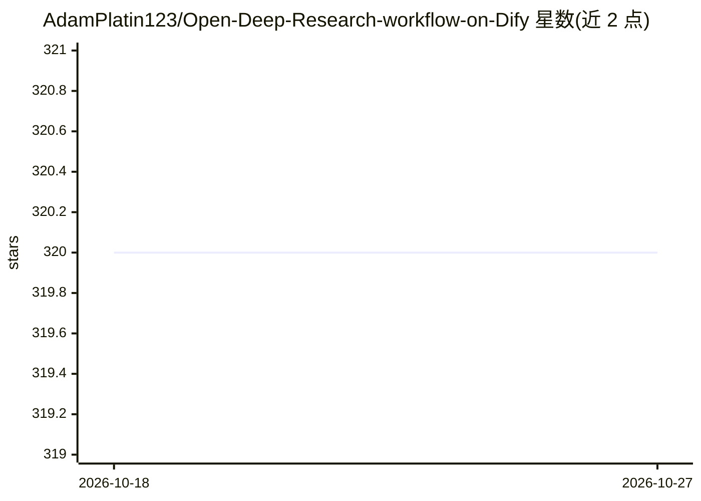

# AdamPlatin123/Open-Deep-Research-workflow-on-Dify

⭐ 320 · 推送 2026-08-18 · [GitHub](https://github.com/AdamPlatin123/Open-Deep-Research-workflow-on-Dify) · 个人维护 · 中文 README

**Dify 平台上的 Deep Research 工作流：多源检索生成带引用长文报告**

基于 Dify 平台构建的深度研究工作流 DSL，复现 Deep Research 类产品功能：用 Gemini 2.0 Flash 做多层级主题拆解（4 维度），混合本地知识库与维基百科/Google/Bing 多通道检索，2>1 模型级联架构控制处理节奏，集成 deepseek-r1-distill 等模型生成万字级 Markdown 结构化研究报告。底层模型与数据源可替换；使用本地模型时可能触发 LLM 节点超时。已被 Awesome-Dify-Workflow 收录署名。

## 筛选速览

| 维度 | 判定 | 备注 |
|---|---|---|
| AI 角色 | `ai-native` | 本体是模型或模型工具 |
| 许可风险 | `none` | — |
| 部署形态 | `None` |  |
| 模型依赖 | — | README 未给出锁定关系 |
| 硬件要求 | — | 无带数字的原话,不猜 |
| 安装摩擦 | `low` | 无编译、无系统依赖或容器化 |
| 成熟度 | — | 结构信号不足 |

## 能力要点

- 本地知识库+维基百科/Google/Bing 多通道混合检索
- 2>1 模型级联架构与条件分支控制处理节奏
- 集成 deepseek-r1-distill 等模型做段落级长文生成
- 被 Awesome-Dify-Workflow（10.7k★）收录并署名

## 适用场景

- 导入 Dify 后自动生成带引用的结构化研究报告
- 结合本地知识库与网络搜索做深度调研
- 作为 Dify 工作流模板二次定制模型与数据源

## 场景标签

`RAG` `科研工具` · 领域:知识与检索

## 证据(README 行号)

> L6: 本工作流基于Dify平台构建，复现了Deep Research的核心功能，通过整合多源检索（本地知识库+网络搜索）与多模型协作，可在5分钟内生成万字级结构化研究报告。系统采用模块化设计，支持灵活替换底层模型与数据源。
> L22:  集成deepseek-r1-distill等模型实现段落级内容生成，支持Markdown结构化输出

## 星数曲线

2026-10-18 320 → 2026-10-27 320（+0）

---
*卡片 v1 · prompt 1.4 · 生成 2026-10-21 · 置信度 high · 依据 README sha `9b0778e66bba` · [字段定义](../../DATASET.md)*
