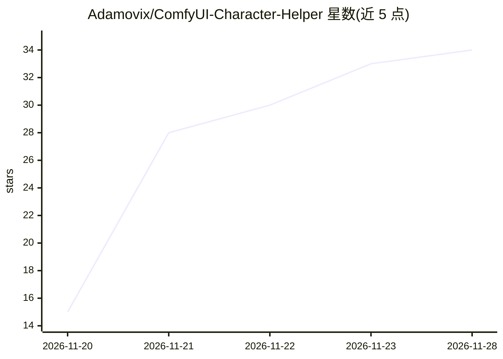

# Adamovix/ComfyUI-Character-Helper

⭐ 34 · Python · MIT · 推送 2026-11-18 · [GitHub](https://github.com/Adamovix/ComfyUI-Character-Helper) · 个人维护

**ComfyUI 自定义节点：用 Danbooru 标签构建角色一致性提示词**

为 ComfyUI 提供一个角色提示词构建节点：支持 39,000 个角色的自动补全，选角后按该角色在 1,170 万条 Danbooru 帖子中的高频标签填充发型、瞳色、服装、姿势、背景等 14 个可编辑字段；字段以 chip 方式编辑，带 17,000 标签补全、按字段掷骰、一键随机化、字段锁定与撤销。标签数据库（13 MB）随仓库附带，运行时不下载；重建数据库需下载约 4 GB 数据和约 8 GB 内存。

## 筛选速览

| 维度 | 判定 | 备注 |
|---|---|---|
| AI 角色 | `ai-ecosystem` | LLM/agent 周边工具 |
| 许可风险 | `permissive` | MIT |
| 部署形态 | `library` | 以包/库形式分发 |
| 模型依赖 | — | README 未给出锁定关系 |
| 硬件要求 | — | 无带数字的原话,不猜 |
| 安装摩擦 | `low` | 无编译、无系统依赖或容器化 |
| 成熟度 | — | 结构信号不足 |

## 能力要点

- 39,000 角色自动补全，选角后自动填充该角色常见标签
- 字段级骰子与整体随机化，从 160,000 张标注图片池抽取兼容标签
- 14 个结构化字段（发型/瞳色/服装/姿势/背景等）chip 式编辑，含锁定与撤销
- 支持 Danbooru 分级上限设置与下划线转空格、括号转义输出选项

## 适用场景

- 在 ComfyUI 中快速为固定角色生成一致的提示词
- 随机生成风格统一的原创角色标签组合
- 按内容分级控制随机标签的来源范围

## 场景标签

`图像生成` · 领域:内容生成

## 证据(README 行号)

> L3: A ComfyUI node that builds a coherent Danbooru-style tag prompt for a character.
> L38: Search for **Character Helper** in ComfyUI Manager, or clone into `ComfyUI/custom_nodes`
> L82: - **Character looks** come from 11.7 million Danbooru posts. For each character only

## 星数曲线

2026-11-20 15 → 2026-11-28 34（+19）

---
*卡片 v1 · prompt 1.4 · 生成 2026-11-20 · 置信度 mid · 依据 README sha `c59da689d951` · [字段定义](../../DATASET.md)*
