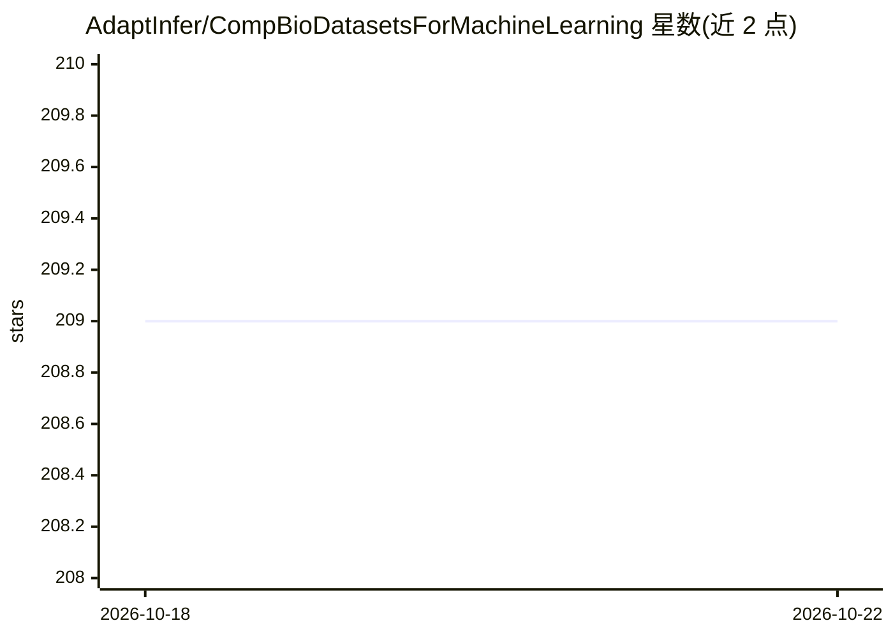

# AdaptInfer/CompBioDatasetsForMachineLearning

⭐ 209 · 推送 2026-09-02 · [GitHub](https://github.com/AdaptInfer/CompBioDatasetsForMachineLearning) · 组织维护

**计算生物学机器学习数据集策展清单（13 类）**

按类别组织的数据集合集：覆盖基因分型、基因/蛋白表达、单细胞、调控网络、生物医学图像、fMRI、电子病历、胸片、蛋白相互作用与结构、纵向研究、自然语言与治疗学等类别，条目以表格列出名称、描述与备注，注明部分数据集的样本量与预处理情况。面向寻找训练数据的计算生物学与机器学习研究者，以 Markdown 清单形式提供，接受社区通过 PR 提交新数据集。清单自述为进行中的工作。

## 筛选速览

| 维度 | 判定 | 备注 |
|---|---|---|
| AI 角色 | `ai-knowledge` | 知识聚合/清单类 |
| 许可风险 | `none` | — |
| 部署形态 | `None` |  |
| 模型依赖 | — | README 未给出锁定关系 |
| 硬件要求 | — | 无带数字的原话,不猜 |
| 安装摩擦 | `low` | 无编译、无系统依赖或容器化 |
| 成熟度 | `idea` | |

## 能力要点

- 13 个计算生物学类别组织数据集条目
- 条目含名称、描述与备注（样本量、任务类型等）
- 通过 pull request 接受社区补充数据集

## 适用场景

- 为机器学习项目寻找计算生物学领域的公开数据集
- 按任务类别（图像、EHR、单细胞、蛋白结构等）浏览可用数据
- 发现带基准或竞赛背景的数据集（如 CheXPert、CAMELYON17）

## 场景标签

`精选清单` · 领域:学习与行业

## 证据(README 行号)

> L1: # Computational Biology Datasets Suitable For Machine Learning
> L2: This is a curated list of computational biology datasets that have been pre-processed for machine learning.

## 星数曲线

2026-10-18 209 → 2026-10-22 209（+0）

---
*卡片 v1 · prompt 1.4 · 生成 2026-10-22 · 置信度 high · 依据 README sha `13869297204d` · [字段定义](../../DATASET.md)*
