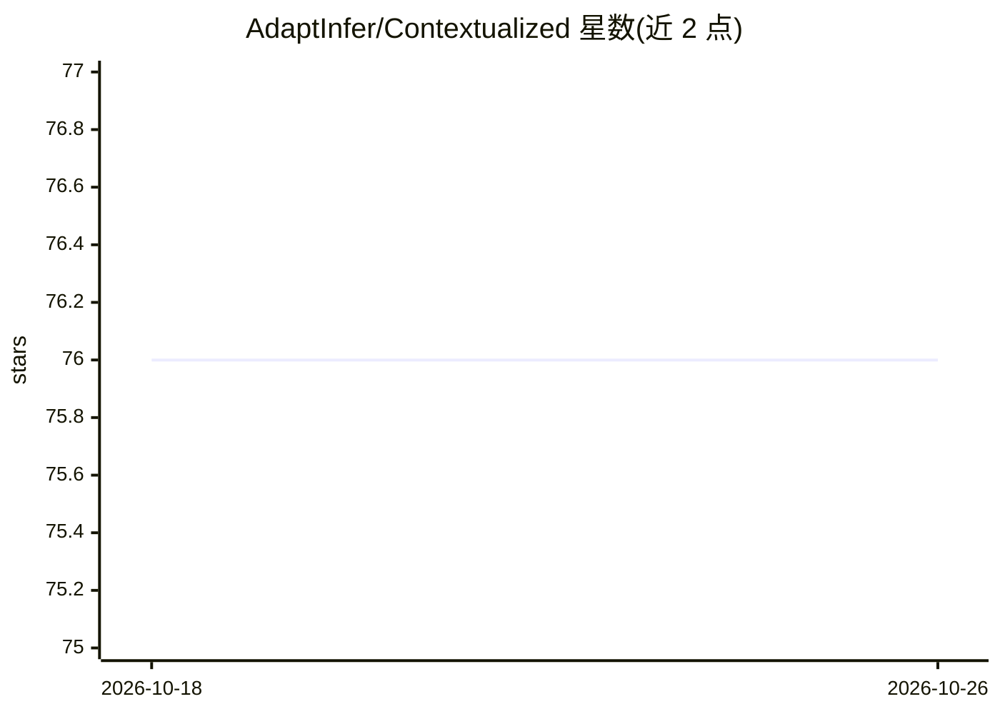

# AdaptInfer/Contextualized

⭐ 76 · Python · GPL-3.0 · 推送 2026-03-06 · [GitHub](https://github.com/AdaptInfer/Contextualized) · [官网](http://contextualized.ml/) · 组织维护

**SKLearn 风格的上下文特定参数统计建模工具箱**

Python 工具箱，将线性回归、逻辑回归、贝叶斯网络、相关性网络与马尔可夫网络等统计模型的参数建模为上下文的函数，通过深度学习模型拟合生成上下文特定系数；提供 sklearn 风格的 ContextualizedRegressor 等封装与 predict_params 接口，支持发现数据中隐藏异质性、识别上下文特定预测因子与领域适应。面向生物信息学、医学信息学与统计建模研究者，附 JOSS 软件论文与系列相关发表。

## 筛选速览

| 维度 | 判定 | 备注 |
|---|---|---|
| AI 角色 | `ai-native` | 本体是模型或模型工具 |
| 许可风险 | `viral` | GPL-3.0 |
| 部署形态 | `library` | 以包/库形式分发 |
| 模型依赖 | — | README 未给出锁定关系 |
| 硬件要求 | — | 无带数字的原话,不猜 |
| 安装摩擦 | `low` | 无编译、无系统依赖或容器化 |
| 成熟度 | — | 结构信号不足 |

## 能力要点

- 将模型参数建模为上下文函数 β(C)，覆盖回归、分类、贝叶斯/马尔可夫网络等模型
- sklearn 风格封装（fit / predict_params）
- 支持异质性发现、上下文特定预测因子识别与领域适应
- 配套软件出版物（JOSS '24）与多篇生物医学应用论文

## 适用场景

- 发现数据中的隐藏异质性或亚型结构
- 构建随上下文变化的个性化预测模型（如患者特定治疗效应）
- 估计样本特异性基因调控网络

## 场景标签

 · 领域:生物信息学/医学信息学统计建模

## 证据(README 行号)

> L13: An SKLearn-style toolbox for estimating and analyzing models, distributions, and functions with context-specific pa
> L30: Contextualized implements this for many types of statistical models, including linear regression, logistic regressi
> L49: This builds a contextualized linear regression model by fitting a deep-learning model to generate context-specific 

## 星数曲线

2026-10-18 76 → 2026-10-26 76（+0）

---
*卡片 v1 · prompt 1.4 · 生成 2026-10-24 · 置信度 high · 依据 README sha `946ee35cc401` · [字段定义](../../DATASET.md)*
