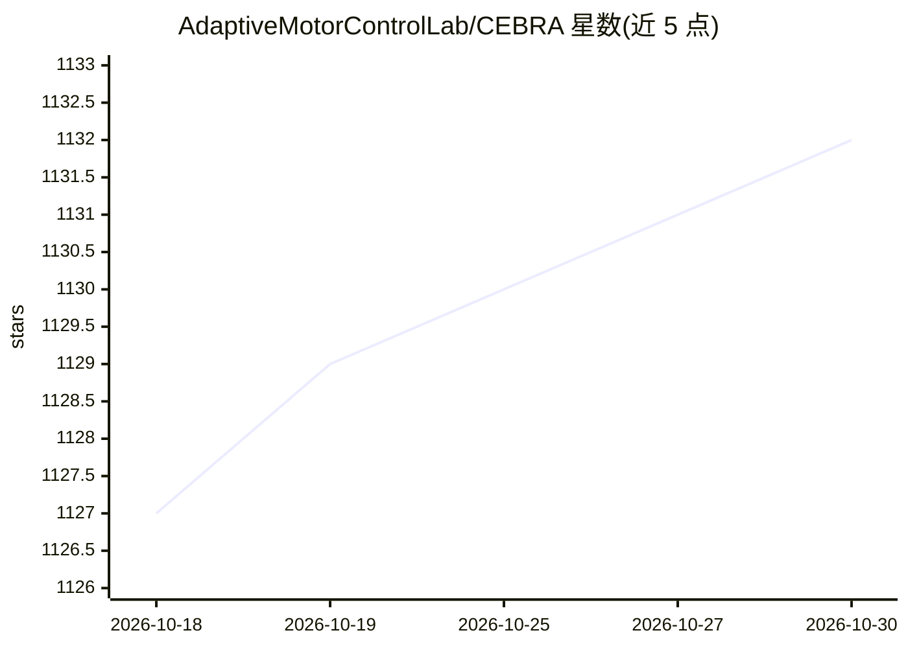

# AdaptiveMotorControlLab/CEBRA

⭐ 1,132 · Python · NOASSERTION · 推送 2026-10-12 · [GitHub](https://github.com/AdaptiveMotorControlLab/CEBRA) · [官网](https://cebra.ai) · 组织维护

**神经与行为数据联合分析的自监督嵌入库（科研）**

基于 PyTorch 实现的自监督对比学习方法库，用于估计高维记录数据的一致性潜在嵌入，可联合使用行为与神经数据，以假设驱动或探索式方式生成潜在空间，用于时间序列分析与行为变量解码。由 EPFL 相关研究团队维护，配套多篇论文（Nature 2023、ICLR 2025、AISTATS 2025），0.4.0 起以 Apache 2.0 开源，方法已获专利授权（需联系 EPFL TTO 洽谈许可）。

## 筛选速览

| 维度 | 判定 | 备注 |
|---|---|---|
| AI 角色 | `ai-native` | 本体是模型或模型工具 |
| 许可风险 | `permissive` | NOASSERTION |
| 部署形态 | `library` | 以包/库形式分发 |
| 模型依赖 | — | README 未给出锁定关系 |
| 硬件要求 | — | 无带数字的原话,不猜 |
| 安装摩擦 | `low` | 无编译、无系统依赖或容器化 |
| 成熟度 | — | 结构信号不足 |

## 能力要点

- 联合行为与神经数据生成一致性潜在嵌入
- 基于 PyTorch 的自监督对比学习实现
- 支持生物学与神经科学常见数据集
- 配套 Nature 2023 / ICLR 2025 / AISTATS 2025 论文

## 适用场景

- 对神经记录与行为数据做联合降维与潜在空间分析
- 提升行为变量解码精度并抵抗域偏移
- 时间序列的非线性聚类与系统辨识

## 场景标签

`科研工具` · 领域:学习与行业

## 证据(README 行号)

> L16: **CEBRA** is a library for estimating **C**onsistent **E**m**B**eddings of high-dimensional **R**ecordings using **
> L21: It can jointly use behavioral and neural data in a hypothesis- or discovery-driven manner to produce consistent, hi

## 星数曲线

2026-10-18 1,127 → 2026-10-30 1,132（+5）

---
*卡片 v1 · prompt 1.4 · 生成 2026-10-21 · 置信度 high · 依据 README sha `1c4832443d75` · [字段定义](../../DATASET.md)*
