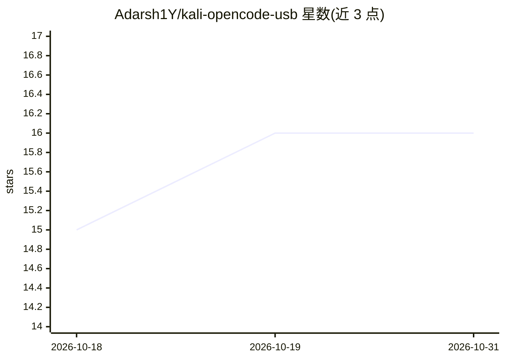

# Adarsh1Y/kali-opencode-usb

⭐ 16 · TypeScript · MIT · 推送 2026-04-03 · [GitHub](https://github.com/Adarsh1Y/kali-opencode-usb) · 个人维护

**可启动 Kali Linux Live USB 构建工具，预置 AI 渗透测试工具链**

提供 build-usb.sh 脚本，将 Kali Linux Live 与 AI 渗透测试工具打包为可持久化 U 盘：OpenCode（TUI/Web 的 AI CLI）、CLI Agent（支持 Ollama 离线运行）、Kali MCP（35+ 安全工具封装为 MCP 工具：端口扫描、DNS 枚举、漏洞扫描、hydra 爆破、报告生成等）、Shannon 插件（基于 600+ Docker 工具的自主渗透测试与浏览器自动化）。面向渗透测试人员，Live 模式仅驻留内存、拔盘无痕。构建需下载约 3GB Kali ISO，耗时 10-20 分钟。

## 筛选速览

| 维度 | 判定 | 备注 |
|---|---|---|
| AI 角色 | `ai-enhanced` | 去掉 AI 部分产品仍成立 |
| 许可风险 | `permissive` | MIT |
| 部署形态 | `None` |  |
| 模型依赖 | local-ok | 支持本地模型 |
| 硬件要求 | — | 无带数字的原话,不猜 |
| 安装摩擦 | `low` | 无编译、无系统依赖或容器化 |
| 成熟度 | — | 结构信号不足 |

## 能力要点

- 一条脚本构建含 AI 工具链的可持久化 Kali Live USB
- Kali MCP 将 35+ 安全工具（扫描/枚举/爆破/报告）暴露为 MCP 工具
- Shannon 插件支持自主渗透测试（600+ Docker 工具、Playwright 浏览器自动化）
- CLI Agent 支持 Ollama 本地模型离线运行

## 适用场景

- 在任意机器从 U 盘启动进行不留痕迹的渗透测试
- 通过 AI agent 以命令方式调用端口扫描、漏洞扫描等工具
- 授权测试中自动化多阶段侦察与漏洞发现并生成报告

## 场景标签

`网络安全` `Agent 框架` · 领域:Agent 开发

## 证据(README 行号)

> L5: A bootable USB drive combining **Kali Linux Live** with **AI-powered pentesting tools**: OpenCode, CLI Agent, Kali M
> L30: - **Full Kali Linux** - Every pentest tool (nmap, metasploit, burp, hashcat, etc.)
> L34: - **Shannon Plugin** - Autonomous pentesting with 600+ Docker tools + browser automation

## 星数曲线

2026-10-18 15 → 2026-10-31 16（+1）

---
*卡片 v1 · prompt 1.4 · 生成 2026-10-30 · 置信度 high · 依据 README sha `758d8d5b5beb` · [字段定义](../../DATASET.md)*
