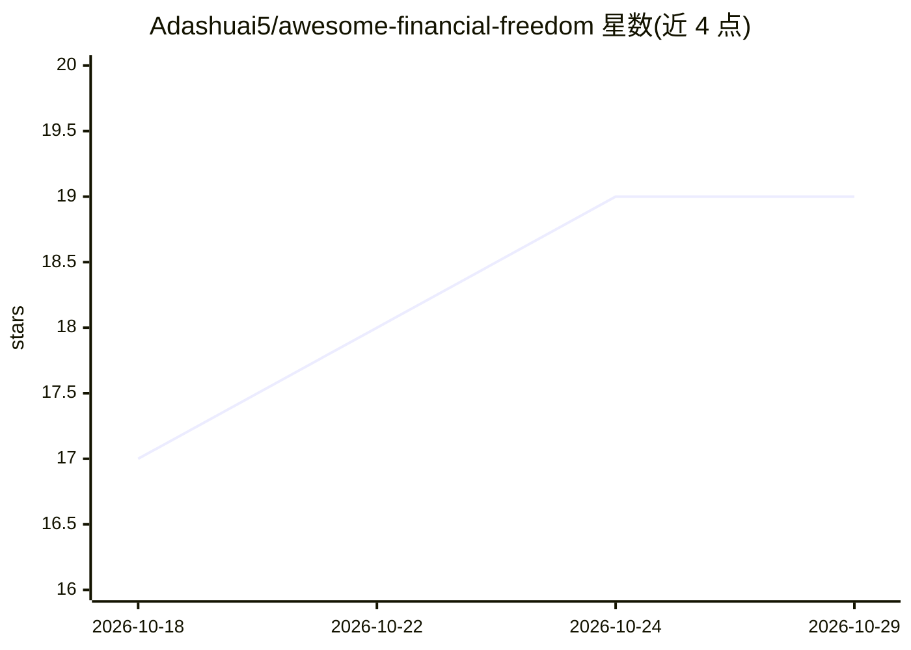

# Adashuai5/awesome-financial-freedom

⭐ 19 · JavaScript · NOASSERTION · 推送 2026-05-21 · [GitHub](https://github.com/Adashuai5/awesome-financial-freedom) · [官网](https://adashuai5.github.io/awesome-financial-freedom/demo/index.html) · 个人维护 · 中文 README

**面向中国投资者的 FIRE 财务自由结构化知识库与工具集**

开源的 AI-native FIRE（财务自由）规划系统：以 28 个 JSON 知识节点、7 阶段知识目录、工作流与提示词模板组织结构化知识，配合 6 个阶段工具（债务计算器、应急基金进度、定投模拟等）与扩展 FIRE 计算器。内建中国税务场景（个税档、个人养老金、公积金）与 A 股/QDII/黄金 ETF 代码。支持浏览器内粘贴自有 Anthropic API Key 流式调用 Claude 分析，或复制 8 段结构化提示词给任意 LLM；另有 Node.js CLI 执行工作流。面向不知道从哪开始的财务初学者，提供在线 demo，无需安装。

## 筛选速览

| 维度 | 判定 | 备注 |
|---|---|---|
| AI 角色 | `ai-knowledge` | 知识聚合/清单类 |
| 许可风险 | `none` | NOASSERTION |
| 部署形态 | `None` |  |
| 模型依赖 | — | README 未给出锁定关系 |
| 硬件要求 | — | 无带数字的原话,不猜 |
| 安装摩擦 | `low` | 无编译、无系统依赖或容器化 |
| 成熟度 | — | 结构信号不足 |

## 能力要点

- 28 个 JSON 知识节点按 7 个阶段组织，结构化供 AI 消费
- 6 个阶段工具与扩展 FIRE 计算器（含中国税务与 ETF 代码）
- BYOK 浏览器内流式调用 Claude 分析，或导出结构化提示词给任意 LLM
- 月度快照跟踪（localStorage）与 CSV/JSON 导出，无后端

## 适用场景

- 通过 5 题诊断自己的 FIRE 阶段并获得对应工具
- 让 AI 基于我的财务数据做深度分析
- 系统学习财务自由各阶段的知识与行动清单
- 在浏览器对比多个储蓄/退休方案

## 场景标签

`金融量化` `教程课程` · 领域:学习与行业

## 证据(README 行号)

> L29: **Awesome Financial Freedom** is an open-source, AI-native FIRE planning system for Chinese investors. It combines 
> L40: - 🧠 **28 JSON knowledge nodes** — visible in-UI knowledge card, structured for accurate AI consumption

## 星数曲线

2026-10-18 17 → 2026-10-29 19（+2）

---
*卡片 v1 · prompt 1.4 · 生成 2026-10-29 · 置信度 high · 依据 README sha `298e8eb72cd0` · [字段定义](../../DATASET.md)*
