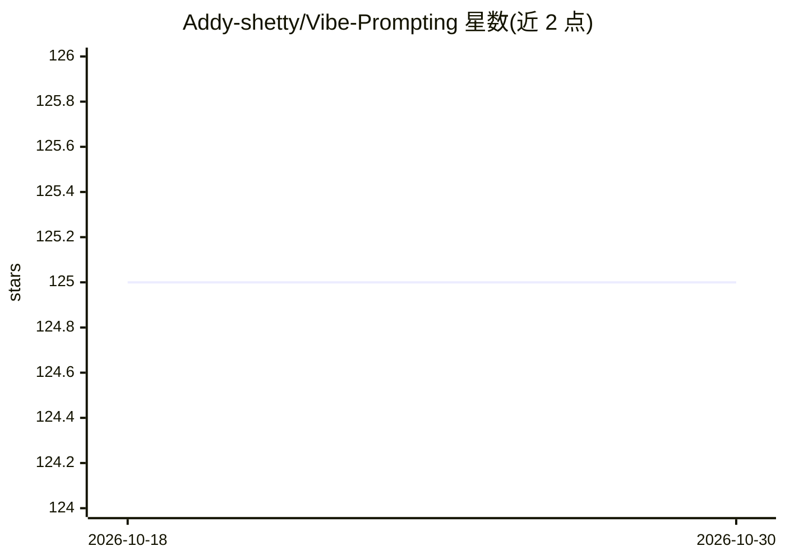

# Addy-shetty/Vibe-Prompting

⭐ 125 · TypeScript · MIT · 推送 2026-07-27 · [GitHub](https://github.com/Addy-shetty/Vibe-Prompting) · [官网](https://vibe-prompting-mod5hmq3z-harshithms1922-8008s-projects.vercel.app) · 个人维护

**面向终端用户的 AI 提示词生成 Web 应用：想法转提示词**

基于 React 18 + TypeScript + Vite 的 Web 应用，将用户想法生成 AI 提示词：主模型 Gemini 2.0 Flash，经 OpenRouter 以 Llama 3.2 作后备。提供 14 个分类（前端、后端、DevOps、安全等）、实时流式生成、标签系统、公共画廊与一键复制。后端用 Supabase（PostgreSQL + RLS + Edge Functions），配额度系统：匿名 3 次免费、注册用户 50 积分。需 Node.js 18+、Supabase 账号与 AI API key，本地 npm 运行或部署 Vercel。

## 筛选速览

| 维度 | 判定 | 备注 |
|---|---|---|
| AI 角色 | `ai-native` | 本体是模型或模型工具 |
| 许可风险 | `permissive` | MIT |
| 部署形态 | `library` | 以包/库形式分发 |
| 模型依赖 | locked-api |  |
| 硬件要求 | — | 无带数字的原话,不猜 |
| 安装摩擦 | `low` | 无编译、无系统依赖或容器化 |
| 成熟度 | — | 结构信号不足 |

## 能力要点

- Gemini 2.0 Flash 主模型 + OpenRouter Llama 3.2 后备生成
- 14 个专门分类（Frontend/Backend/DevOps/Security 等）
- 实时流式生成与公共画廊
- Supabase RLS、Zod 输入校验、限流等安全实现
- 匿名 3 次免费生成、注册用户 50 积分的额度系统

## 适用场景

- 把粗略想法快速变成结构化 AI 提示词
- 按开发领域分类浏览和保存提示词
- 在社区画廊发现并复用他人提示词

## 场景标签

`提示工程` · 领域:Agent 开发

## 证据(README 行号)

> L3: **AI-Powered Prompt Generator with Smart Credit System**
> L27: - ✅ **AI Prompt Generation** - Powered by Google Gemini 2.0 Flash & OpenRouter
> L74: - 🤖 **Gemini 2.0 Flash** - Primary model

## 星数曲线

2026-10-18 125 → 2026-10-30 125（+0）

---
*卡片 v1 · prompt 1.4 · 生成 2026-10-23 · 置信度 high · 依据 README sha `1a53695b9863` · [字段定义](../../DATASET.md)*
