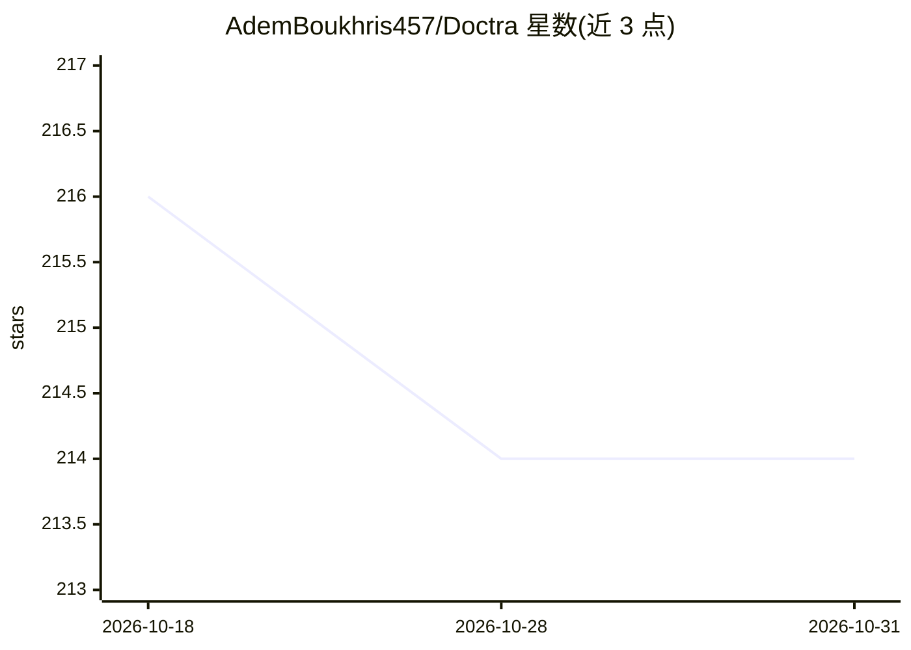

# AdemBoukhris457/Doctra

⭐ 214 · Jupyter Notebook · Apache-2.0 · 推送 2025-11-29 · [GitHub](https://github.com/AdemBoukhris457/Doctra) · [官网](https://ademboukhris457.github.io/Doctra/) · 个人维护 · 中文 README

**面向开发者的文档解析库：PDF/DOCX 提取 OCR 与结构化输出**

Python 库，提供多个解析器处理 PDF 与 DOCX：布局检测（PaddleOCR）、OCR 文字提取（PyTesseract/PaddleOCR）、图表/表格转结构化数据（可选 VLM 引擎，依赖注入方式配置）、DocRes 图像修复（去畸变/去阴影/去模糊等 6 种任务）。输出 Markdown/HTML/Excel/JSON。附 Gradio Web UI 供非技术用户拖拽处理文档，并有 CLI 命令。运行需系统级安装 Poppler；VLM 与图像修复为可选功能。

## 筛选速览

| 维度 | 判定 | 备注 |
|---|---|---|
| AI 角色 | `ai-native` | 本体是模型或模型工具 |
| 许可风险 | `permissive` | Apache-2.0 |
| 部署形态 | `library` | 以包/库形式分发 |
| 模型依赖 | local-ok | 支持本地模型 |
| 硬件要求 | — | 无带数字的原话,不猜 |
| 安装摩擦 | `medium` | 含编译或系统依赖之一 |
| 成熟度 | — | 结构信号不足 |

## 能力要点

- StructuredPDFParser：布局检测+OCR+视觉元素提取，输出 Markdown/Excel/JSON
- EnhancedPDFParser：DocRes 图像修复（去畸变/去阴影/去模糊/二值化等）后再解析
- OCR 与 VLM 引擎采用依赖注入模式，可外部初始化替换
- Gradio Web UI 与 CLI 双入口，支持 PDF/DOCX

## 适用场景

- 把扫描或低质量 PDF 修复后转成 Markdown/Excel
- 批量提取文档中的表格与图表为结构化数据
- 非技术用户通过网页界面上传 PDF 获得解析结果

## 场景标签

`文档解析` `OCR` · 领域:知识与检索

## 证据(README 行号)

> L72: The `StructuredPDFParser` is a comprehensive PDF parser that extracts all types of content from PDF documents. It p
> L75: - **Layout Detection**: Uses PaddleOCR for accurate document layout analysis
> L78: - **VLM Integration**: Optional conversion of visual elements to structured data

## 星数曲线

2026-10-18 216 → 2026-10-31 214（-2）

---
*卡片 v1 · prompt 1.4 · 生成 2026-10-22 · 置信度 high · 依据 README sha `5e3cd46f2bde` · [字段定义](../../DATASET.md)*
