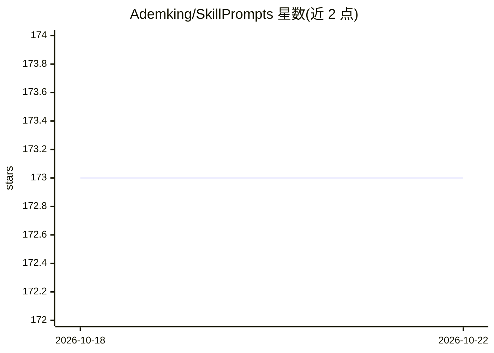

# Ademking/SkillPrompts

⭐ 173 · TypeScript · MIT · 推送 2026-05-17 · [GitHub](https://github.com/Ademking/SkillPrompts) · [官网](https://skillprompts.surge.sh) · 个人维护

**跨 AI 聊天平台复用提示词的浏览器扩展**

面向 AI 聊天平台用户的浏览器扩展（Chrome/Edge/Brave/Firefox）：创建、组织并在聊天输入框中快速插入带变量的可复用提示词库，内置多种预置提示词，支持可复用文本块、提示词预览、收藏及 JSON 导入导出。当前支持 ChatGPT 与 Gemini，另列十余个站点在路线图中未支持。安装方式为从 releases 下载解压包后以开发者模式加载，无应用商店上架说明。

## 筛选速览

| 维度 | 判定 | 备注 |
|---|---|---|
| AI 角色 | `ai-ecosystem` | LLM/agent 周边工具 |
| 许可风险 | `permissive` | MIT |
| 部署形态 | `desktop` | 安装包/桌面程序 |
| 模型依赖 | — | README 未给出锁定关系 |
| 硬件要求 | — | 无带数字的原话,不猜 |
| 安装摩擦 | `low` | 无编译、无系统依赖或容器化 |
| 成熟度 | — | 结构信号不足 |

## 能力要点

- 提示词库支持自定义变量与可复用文本块
- 在支持站点输入 / 唤起并插入提示词
- 提示词 JSON 导入/导出与收藏功能
- 提供 Chromium 与 Firefox 两版构建

## 适用场景

- 在 ChatGPT/Gemini 等平台快速插入常用提示词
- 统一管理带占位变量的技能提示词库
- 在不同设备间备份迁移提示词库

## 场景标签

`提示工程` · 领域:Agent 开发

## 证据(README 行号)

> L5: A browser extension to create, organize, and reuse customizable AI prompts across multiple AI chat platforms for fas
> L9: - Create and manage a library of AI skill prompts with customizable variables.
> L10: - Quickly insert prompts into ChatGPT and other supported sites.

## 星数曲线

2026-10-18 173 → 2026-10-22 173（+0）

---
*卡片 v1 · prompt 1.4 · 生成 2026-10-22 · 置信度 high · 依据 README sha `0852989bede9` · [字段定义](../../DATASET.md)*
