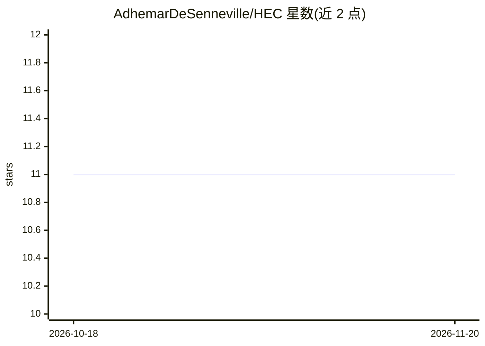

# AdhemarDeSenneville/HEC

⭐ 11 · Python · 推送 2026-07-06 · [GitHub](https://github.com/AdhemarDeSenneville/HEC) · [官网](https://adhemardesenneville.github.io/HEC/) · 组织维护

**研究代码：LVLM 上免训练的少样本/零样本图像分类方法**

ECCV 2026 论文的官方实现，提出 Head Ensemble Classifiers (HEC)：无需训练的少样本与零样本图像分类统一框架，通过 prompt 条件化特征提取并桥接 CLIP 类与 LVLM 类方法。提供三种模式：HEC-V（视觉头少样本）、HEC-T（文本头零样本）、HEC-VT（二者结合）。在 CLIP 风格数据集（EuroSAT、UCF101 等 10 个）与 Meta-Dataset 上评测，backbone 支持 QWENv2 与 LLaVA_OV，可自定义扩展。源码安装或经 Colab 笔记本运行。

## 筛选速览

| 维度 | 判定 | 备注 |
|---|---|---|
| AI 角色 | `ai-native` | 本体是模型或模型工具 |
| 许可风险 | `none` | — |
| 部署形态 | `None` |  |
| 模型依赖 | — | README 未给出锁定关系 |
| 硬件要求 | — | 无带数字的原话,不猜 |
| 安装摩擦 | `low` | 无编译、无系统依赖或容器化 |
| 成熟度 | — | 结构信号不足 |

## 能力要点

- 免训练框架：HEC-V/HEC-T/HEC-VT 三种分类模式
- backbone 支持 QWENv2 与 LLaVA_OV，可自行实现接入
- 提供最小可运行的 Colab 笔记本
- 覆盖 10 个 CLIP 风格数据集与 Meta-Dataset 评测路径

## 适用场景

- 复现论文中 LVLM 头选择的少样本分类实验
- 在只有类名或只有带标注支持集的场景下做图像分类评测
- 将自有 LVLM 模型接入 HEC 评测框架

## 场景标签

`模型评测` · 领域:评测与运维

## 证据(README 行号)

> L15: **Head Ensemble Classifiers (HEC)** is a training-free unified framework for few-shot and zero-shot image classific
> L17: - `HEC-V`: Classify few-shot using the best vision-heads.
> L80:   backbone=QWENv2 \ # or LLaVA_OV or your own implemented model

## 星数曲线

2026-10-18 11 → 2026-11-20 11（+0）

---
*卡片 v1 · prompt 1.4 · 生成 2026-11-19 · 置信度 high · 依据 README sha `306d5d1af0e5` · [字段定义](../../DATASET.md)*
