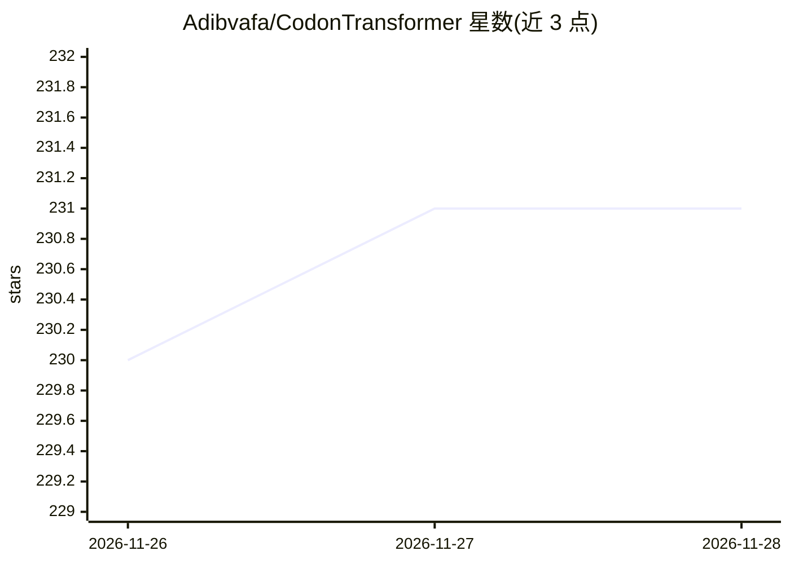

# Adibvafa/CodonTransformer

⭐ 231 · Python · Apache-2.0 · 推送 2026-11-27 · [GitHub](https://github.com/Adibvafa/CodonTransformer) · [官网](https://adibvafa.github.io/CodonTransformer) · 个人维护

**面向科研与生物技术从业者的密码子优化深度学习工具**

基于 Transformer 的多物种密码子优化模型，在来自 164 个物种的 100 万以上 DNA-蛋白质对上训练，输入蛋白序列与目标宿主物种，生成具有自然密码子分布特征的宿主特异性 DNA 序列。提供 Python 包接口（pip 安装）、Google Colab 演示、批量推理与温度/top_p 可控的多序列生成，并支持用自有数据集微调（含 SLURM 脚本示例）；支持模糊氨基酸的多种预处理策略。模型权重首次使用时单独下载。

## 筛选速览

| 维度 | 判定 | 备注 |
|---|---|---|
| AI 角色 | `ai-native` | 本体是模型或模型工具 |
| 许可风险 | `permissive` | Apache-2.0 |
| 部署形态 | `library` | 以包/库形式分发 |
| 模型依赖 | — | README 未给出锁定关系 |
| 硬件要求 | — | 无带数字的原话,不猜 |
| 安装摩擦 | `low` | 无编译、无系统依赖或容器化 |
| 成熟度 | — | 结构信号不足 |

## 能力要点

- 164 个物种训练数据，支持按名称或 ID 指定宿主
- 非确定性解码支持 temperature/top_p 参数与多序列生成
- 提供 prepare_training_data 与 finetune.py 的自有数据微调流程
- 模糊氨基酸行为可配置（随机/确定性/报错）

## 适用场景

- 为异源蛋白表达设计目标宿主的 DNA 序列
- 为特定物种批量生成多条候选优化序列
- 用自己的 DNA-蛋白质对数据微调模型

## 场景标签

`科研工具` · 领域:学习与行业

## 证据(README 行号)

> L12: The genetic code is degenerate allowing a multitude of possible DNA sequences to encode the same protein. This dege
> L22: from CodonTransformer.CodonPrediction import predict_dna_sequence

## 星数曲线

2026-11-26 230 → 2026-11-28 231（+1）

---
*卡片 v1 · prompt 1.4 · 生成 2026-11-28 · 置信度 high · 依据 README sha `d530744e8951` · [字段定义](../../DATASET.md)*
